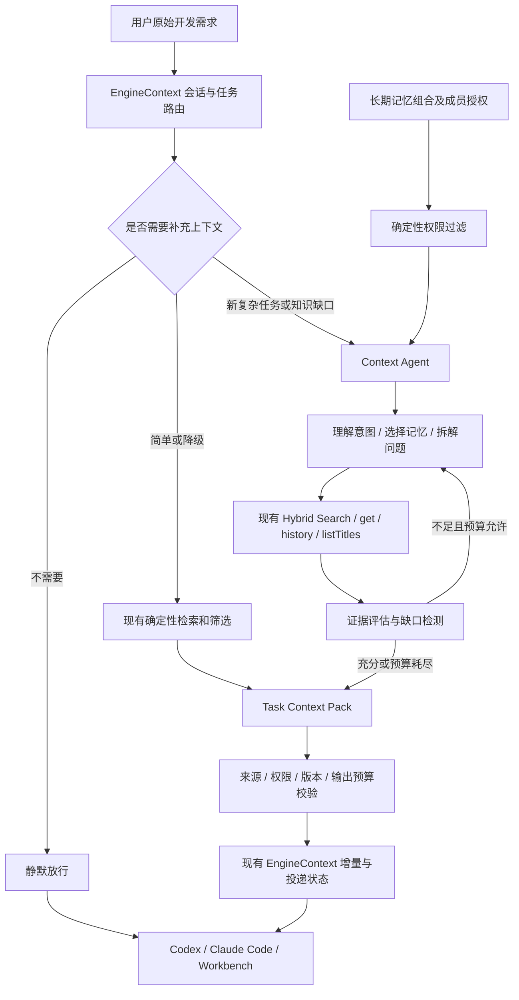

# Agentic RAG & Adaptive Context Engineering Plan

**项目：** Project Knowledge（project-knowledge-base）  
**计划类型：** Codex 可执行开发与验收计划  
**基线日期：** 2026-11-27（此前远程 Git 只读审查）  
**主目标：** 在保留现有知识库架构的前提下，让开发 Agent 更准确地理解用户、理解项目、获得当前任务真正需要的背景信息，并减少重复上下文和开发返工。  
**交付状态：** 开发计划，不代表功能已实现或本地验收已通过。

---

## 0. 给 Codex 的执行指令

将本文件保存到工作区后，可直接向 Codex 提交以下指令（如使用目标模式，则作为目标说明）：

> 以 `Agentic_RAG_Adaptive_Context_PLAN.md` 为唯一的本轮实施计划，完整阅读后按 M0 → M1 → M2 → M3 顺序实际执行。先只读核对当前各仓库的 Git 状态、AGENTS.md、运行时模块版本、源码和历史提交，再建立基线。不要推倒重来，不要重复实现现有 Hybrid Search、长期记忆组合和 Session Index。遵循本文件的模块边界、数据保护、测试及发布门禁。必须实现面向真实开发需求的 Agentic RAG、长期记忆按任务筛选和跨轮增量上下文注入，并验证 Codex/Claude Code 等真实开发工具实际收到并使用相关知识。每个阶段完成后运行对应测试、记录可复现证据、创建明确的 Git 检查点；发现问题先定位根因再修复。不要用 Mock 成功代替真实模型或客户端验收。不得修改真实知识数据、生产配置或未经授权发布 npm。不要只给出方案或停留在分析；在具备实施条件时持续完成代码、测试和验证，遇到真实外部阻塞则记录具体原因、完成不受阻塞的部分，最终明确 PASS / FAIL / BLOCKED 与剩余工作。优先保持简单、解耦和低 Token 消耗，不引入不必要的框架或微服务。

**完成定义：** 不仅能从知识库界面执行 Agentic RAG，而且在正常开发会话中，开发 Agent 能以可靠、低干扰的方式获得与当前任务匹配的长期记忆及项目知识；新任务触发必要的深度检索，普通追问不产生重复上下文，复杂需求的真实开发质量优于当前基线。

## 1. 背景、现状与基线

### 1.1 已确认的远程基线

此前审查涉及 `SanQianX` 下的 GitHub 仓库。以下版本来自 2026-11-27 主仓库 `main` 的 `package.json`，不是当前机器已安装版本的证明；执行 M0 时必须重新确认本地及远程 HEAD、依赖锁和运行时版本。

| 仓库/模块 | 审查时版本 | 职责 |
|---|---|---|
| project-knowledge-base | 5.5.1 | 宿主、模块连接、配置与 UI、客户端集成 |
| knowledge-engine | 0.4.2 | 知识生成、检索、记忆可见性和上下文 |
| vector-hub | 1.0.8-rc.10 | 派生向量索引与召回 |
| Claude-Ai-Workbench | 0.13.15 | Agent 运行、模型配置及会话 |
| ai-coding-workflow | 0.4.1 | AI 团队、任务编排与 Review |
| ai-coding-event-bridge | 0.7.5-rc.2 | Git / 开发会话事件采集 |

- 主仓库版本基线：[package.json](https://github.com/SanQianX/project-knowledge-base/blob/677b674e54d710a804e209bec8ea9f224c274d2c/package.json)；发布提交 `677b674e54`；审查时最近提交 `15aee0fe2d`。
- 知识引擎发布基线：[7846033bf7](https://github.com/SanQianX/knowledge-engine/commit/7846033bf72c3909df5b10db32435430659cdb5d)。
- 向量模块发布基线：[073534d15f](https://github.com/SanQianX/vector-hub/commit/073534d15fd7ca19812aa21729a90ed6a3ca0859)。
- Workbench 发布基线：[4486bc05fe](https://github.com/SanQianX/Claude-Ai-Workbench/commit/4486bc05fe8c9f3915595cc71aeb610a837d6b98)。

### 1.2 已有历史成果：必须复用而非回退

| 提交 | 已有机制 | 本轮要求 |
|---|---|---|
| [3ede90d](https://github.com/SanQianX/project-knowledge-base/commit/3ede90d9990a53038a992035bd99c2ba9dffbb6f)，2026-11-11 | Session Index：首轮索引与适用记忆，后续静默或记忆增量，10 轮提示冷却、30 轮目录刷新，30 轮累计注入 ≤10 KB 回归 | 现有快速路径完整兼容；智能路径继续任务级去重，不恢复逐轮全量注入 |
| [51644bc](https://github.com/SanQianX/project-knowledge-base/commit/51644bc3c567234cf212b322bbef8d70dd6e5159)，2026-11-22 | 强匹配知识摘录、证据计数、冷却与日志脱敏 | 复用证据校验，避免固定冷却屏蔽真实新证据；保留原有测试 |
| [182338c](https://github.com/SanQianX/knowledge-engine/commit/182338cb6614990c9824f787e20162a6121e7fe9)，2026-11-22 | 长期记忆统一组合绑定，确认且归入适用组合后生效 | 保留组合、绑定、确认、删除及迁移语义 |
| [520a8f7](https://github.com/SanQianX/knowledge-engine/commit/520a8f79e7b859777393bba51ba7f6653d08a98d)，2026-11-15 | Agent 成员记忆面、受信上下文绑定 | 复用有效成员记忆范围，验证最新版本中实际可用性 |
| [6fc95ee](https://github.com/SanQianX/knowledge-engine/commit/6fc95ee9108ef371389563b5a98f92f01f15c64b)，2026-11-11 | context/search/get 统一记忆可见性 | 智能检索不得绕过已有可见性检查 |

现有检索由 Knowledge Engine 完成：中文 BM25 + 向量片段 RRF、当前项目优先、文件/Commit 标识匹配、短追问继承、当前文件正文和来源校验、向量异常时 `file-fallback`。`/api/ask` 在审查文档中为确定性答案与引用，不是 LLM 推理答案。无需重建 Hybrid Search 或向量数据库。

已审查的主要接入点（最终路径以 M0 实际 HEAD 为准）：

- [knowledge-engine/src/context.js](https://github.com/SanQianX/knowledge-engine/blob/main/src/context.js)：`EngineContext`、`collectMemories()`、`memoryBlock()`、`evidenceBlock()`、`prepareTurn()`、`sessionIndexes`、`memoryHashes`、`evidenceKeys`；同会话请求串行化、会话 TTL 与容量限制。审查时已有记录在准备响应阶段更新；不等价于真实客户端已接收。
- [knowledge-engine/src/coordinator.js](https://github.com/SanQianX/knowledge-engine/blob/main/src/coordinator.js)：`EngineRetrieval`、`MemoryService`、`AgentMemberService`、`EngineContext` 的依赖组装。
- [knowledge-engine/src/server.js](https://github.com/SanQianX/knowledge-engine/blob/main/src/server.js)：`/api/search`、`/api/ask`、`/api/get`、`/api/history`、`/api/context`。
- [knowledge-engine/README.md](https://github.com/SanQianX/knowledge-engine/blob/main/README.md)：正式检索、记忆可见性、模型运行配置及恢复契约。
- [project-knowledge-base/tests/context-session-index-test.js](https://github.com/SanQianX/project-knowledge-base/blob/main/tests/context-session-index-test.js)：静默、强匹配、跨项目干扰、记忆变化、删除及 30 轮累计注入测试。
- [project-knowledge-base/docs/repository-layout.md](https://github.com/SanQianX/project-knowledge-base/blob/main/docs/repository-layout.md)：主仓库采用 `src/`、`tests/`、`resources/ui/` 布局，不能沿用已迁移的 `_site` 目录作为新实现位置。

自动上下文客户端现有文档约定总超时 10 秒；引擎有首轮索引、记忆、证据和总 prompt 字符预算（审查源码默认 `indexBudget:3000`、`memoryBudget:1500`，策略可覆盖，文档另有总 8000 字符上限）。不得把字符数当作 Token 数，不硬编码覆盖实际策略。M0 核实各端生效预算、请求路径与实际能力，区分安装/启用/受信/实际投递/模型使用等状态。

### 1.3 当前问题

1. 语义相似并不等价于真实开发意图；单次召回不足以找到多模块依赖、历史决策或隐含开发约束。
2. 记忆组合表示访问资格，不表示每条记忆都与此次任务相关；适用记忆的首次批量注入仍可能带来无关内容。
3. Session Index 已减少重复，但尚需面向任务变化、证据版本、客户端投递和压缩后的上下文有效性进行管理。
4. 当前开发 Agent 可能需要自行理解大量候选知识，或多次人工追问用户才能得到背景。

## 2. 目标与非目标

### 2.1 产品目标

- 了解用户：从有权读取的确认记忆中选择本次任务需要的偏好、规范和经验；不修改原始用户需求。
- 了解项目：利用原有检索工具进行自主问题拆解、查询改写、并行搜索、证据检查和必要的再次检索，生成可追溯的任务背景。
- 了解会话：识别任务开启、继续、补充、主题切换、明确重新检索及有效上下文缺失；仅提供新增、变化或必要恢复的信息。
- 能自动使用：正常开发入口不要求用户反复输入“请先查知识库”；客户端未支持或未实际触发时必须如实显示。
- 低成本：控制总开发耗时与总 Token（包括检索模型、工具上下文、开发模型），而非单纯追求召回数量。
- 稳定安全：原有无模型快速路径可继续使用，模型失败不阻塞开发，不扩大授权或破坏真实数据。

### 2.2 明确不做

不替换原有 Embedding / BM25 / RRF，不建立第二套索引、第二套长期记忆数据库、第二个会话管理器、额外常驻微服务或复杂多 Agent 编排；第一版不强制引入 LangGraph。不得改变 Git Hook → journal → 知识分析 → 晋升 → 索引的生产流程，不把原始开发会话/未晋升证据直接当作可信知识，不引入自动记忆确认或修改。不得把检索内部逻辑放到 AI Coding Workflow 或主仓库 shell。不得无授权修改源码仓库之外的用户数据或发布 npm。

## 3. 总体架构与职责



| 模块 | 本轮职责 |
|---|---|
| knowledge-engine | Context Agent 核心、受限只读检索工具、任务记忆筛选、证据验证、任务状态与增量组装；复用 `EngineContext` |
| project-knowledge-base | 配置、知识检索页面、模块代理、Hook/MCP/Skill/CLI 客户端适配、产品验收 |
| Claude-Ai-Workbench | 复用已有模型 Profile、独立用途模型的安全运行接口、在开发模型调用前准备/投递上下文；优先复用宿主已有能力 |
| vector-hub | 不变，继续提供原有检索接口；仅在经证据证明必须修复时变更 |
| ai-coding-workflow | 第一版保持现有编排契约，后续可按需消费统一 Context Pack；不实现检索逻辑 |
| ai-coding-event-bridge | 保持现有事件采集；仅在实际需要且已有能力不能满足时最小扩展客户端上下文生命周期信号 |

建议在 `knowledge-engine/src/agentic-context/` 下组织必要模块：`context-agent.js`、`retrieval-tools.js`、`task-router.js`、`memory-selector.js`、`context-pack.js`、`prompts.js`（可根据现有代码合并小文件，不为目录形式而拆分）。保留 `EngineContext` 为唯一自动注入协调入口。遵守引擎零新增 npm 依赖、CommonJS、宿主提供运行时模型能力的约定；除非有明确需求，不新增依赖。

## 4. 实施契约 A：长期记忆按任务匹配

### 4.1 资格、相关性、投递三层分离

1. **权限层**：复用当前有效组合、项目归属、已确认状态和受信成员绑定检查。候选、ignored、删除、未绑定或失效记忆一律不得出现在模型请求、检索结果、缓存和 Context Pack 中。`scope` 只能在当前请求授权内收窄，不允许模型自主扩大到其他项目、成员或 Brain。
2. **相关性层**：先提供受限候选摘要/标题/原始记忆 ID、明确约束和当前任务摘要；使用现有可见性检索以及 Context Agent 的语义筛选，按需读取全文，而不是把所有适用记忆完整送给开发模型。任务扩展时允许再次选择之前未使用的记忆。避免仅使用关键词筛选导致隐含约束遗漏。
3. **投递层**：对选中的记忆按 ID + revision/正文哈希去重；未变化且确认已投递的记忆不再发。来自同一记忆的多个组合投影只计一次。不得把未被此次选中当作删除或解绑。

### 4.2 注入策略

如现有数据模型没有等价属性，建议最小化增加可选 `injectionPolicy`（名字可调整）：`auto`（按任务匹配）、`always`（用户明确强制执行）、`on-demand`（仅显式或深度工具按需读取）。旧记录缺少属性时，仅在新智能模式中按 `auto` 解释；关闭智能功能时保留旧行为。不得批量改写旧正文或自动将普通偏好标记为强制约束。若需要持久化新字段，必须复用 EngineStore 安全写入、备份、兼容性测试和现有记忆 UI；不重做组合管理。

`always` 仍必须通过权限层，不意味着每轮重复发送。首次需要且未可靠投递、发生变化或明确恢复上下文时提供。强制记忆的有效内容不得被 LLM 压缩掉关键要求或被普通预算静默截断；超预算时显示明确的缺口并提供分批读取路径。未显式标记的普通记忆若确实包含相关开发规范，也应被筛选器选中；以真实评测验证遗漏率。

当前明确用户请求优先于普通历史偏好；安全/权限边界不能被任何记忆覆盖。旧的硬性规则与当前用户指令发生冲突时，保留事实、说明冲突，交给开发 Agent 或用户明确处理，而不是擅自重写要求。

### 4.3 候选与证据要求

- 不允许模型凭空生成不存在的记忆 ID、组合 ID、正文或结论。
- 保留 `memoryId`、有效版本、来源类型及已有证据；手动记忆可以无 Commit，不能伪造引用。
- 记忆、知识文件及共享组合投影语义不同；读取、筛选、呈现时保持身份，不把记忆当普通项目事实。
- 记忆编辑、撤销、解绑和成员变化需使候选与缓存即时失效；异步完成前再次确定性校验。
- 发送给模型的原文必须属于当次授权范围；对于共享组文件，不得因为某条记忆有权限而泄露同文件中的其他未授权记忆。

## 5. 实施契约 B：Context Agent 与 Agentic RAG

### 5.1 单 Agent、有限循环、真实自主决策

输入由系统组装：原始用户需求（保持原文）、当前项目与可信身份、允许的 scope、当前任务摘要及当前已提供的证据 ID/版本、适用强制记忆、受限候选记忆。短追问可使用有界的任务摘要与近期用户意图，避免把整个聊天历史交给模型。不要将开发 Agent 的完整推理或原始会话记录复制到知识系统。

Agent 按实际需求执行：

1. 识别用户真实目标、交付物、限制、提到的代码实体及隐含背景；提出不确定项，不擅自替用户确认需求。
2. 选择适用记忆，建立任务所需的知识问题和检索计划。
3. 通过工具调用现有 Hybrid Search；按需并行执行针对不同知识缺口的子查询。
4. 读取少量高价值原文，检查证据是否真实、足够、互补，识别矛盾、历史与当前状态的差别。
5. 只有确实存在缺口且预算允许时才改写问题继续检索；允许零轮、单轮及提前终止，不固定执行三轮。
6. 生成结构化 Task Context Pack。未找到可靠证据时显式输出 `partial` 或 `no_reliable_match` 及缺口，不编造结论、不强行填充背景。

必须测试一个只有根据首轮工具返回才能确定第二轮检索词的案例；若实现只把预设搜索结果交给 LLM 总结，不能称为 Agentic RAG 验收通过。

### 5.2 工具白名单

| 建议逻辑工具名 | 实现原则 |
|---|---|
| `search_knowledge` | 复用 EngineRetrieval.search，保持授权、项目优先、匹配状态和来源校验 |
| `read_knowledge` | 复用 get，仅允许已授权、规范化的 entryId；有界原文/片段 |
| `search_memories` | 在当前有效确认记忆集合内检索和选择 |
| `read_memory` | 通过既有可见性服务按 ID 读取，版本校验 |
| `get_project_context` | 读取已登记的项目/领域基础信息，不能任意读取磁盘 |
| `get_knowledge_history` | 复用 history，返回可追溯 Commit 依据 |
| `list_knowledge_titles` | 复用 listTitles，有界分页 |

不得开放 shell、任意文件访问、Git 写操作、网络自由访问、记忆修改、知识晋升、任务编排工具。Agent 工具调用参数必须通过严格的 schema、长度、范围、身份和工具调用预算校验；不能让工具名或 scope 由模型绕过。以检索到的文档为不受信证据，而非运行指令，测试文档中伪造系统提示、要求读其他项目、要求修改记忆等注入攻击。

### 5.3 输出合同（拟议 v1，字段可随现有约定调整）

```json
{
  "schemaVersion": 1,
  "requestId": "request-id",
  "projectId": "project-id",
  "taskContextId": "task-id",
  "status": "ready",
  "mode": "agentic",
  "userIntent": "对原始开发需求的简洁理解，不替换原文",
  "selectedMemories": [
    {"memoryId": "m1", "version": "hash", "policy": "auto", "text": "适用约束", "referenceIds": ["r1"]}
  ],
  "projectFacts": [
    {"factId": "f1", "text": "经核实的知识内容", "kind": "verified-knowledge", "referenceIds": ["r2"]}
  ],
  "historicalDecisions": [],
  "reusableCapabilities": [],
  "developmentConstraints": [],
  "knownIssues": [],
  "conflictingEvidence": [],
  "knowledgeGaps": [],
  "references": [],
  "budget": {"rounds": 1, "toolCalls": 3, "modelCalls": 2},
  "delivery": {"kind": "delta", "packId": "pack-id"}
}
```

说明：实际引用必须包含可验证的 `projectId/spaceId/entryId/documentHash`、对应片段坐标或证据定位及可用时的 `commitSha`，或 `memoryId/version/sourceType`。示例仅说明结构。模型只能引用本次工具实际返回且通过校验的证据；有意义的事实没有依据时不得写入已确认事实。区分 `verified-knowledge`（已验证知识库原文）与 `historical`（历史依据）、`inference`（推断）；不能保证历史知识等于当前源码，应提示 Coding Agent 核对工作树。

**开发 Agent 的最终输入 = 用户原始需求 + 必要且未重复的 Context Pack + 开发 Agent 自身读取的当前源码与 Git 状态。** 内部检索轨迹、中间推理、全量候选和重复引用正文不应进入开发提示词。普通 UI 可展示结构化结果、来源、检索模式、轮次和缺口；不需要展示隐含推理过程。

### 5.4 独立模型配置与运行时

优先复用 Workbench 的既有模型 Profile/宿主模型调用方式，新增 Context Agent 用途选择，与知识分析、开发、Leader、Review 模型分开；无需重复录入 API Key。仅传递可信配置引用或既有运行时授权，不落盘明文凭据，不把凭据或原始提示词写日志。支持实际可用的工具调用/结构化响应模型；模型不可用、额度不足、超时、格式错误时明确降级。复用宿主现有 SDK/适配器而非为每家模型重新写一套 SDK。独立检索请求不得被采集为用户开发需求或触发知识生成；避免内部模型会话再次触发自动上下文 Hook 造成递归。

## 6. 实施契约 C：任务级与会话级上下文

### 6.1 模式与自动路由

- **Legacy/Fast（兼容路径）**：关闭新增智能模式时，完整保留现有 Session Index、Hybrid Search、记忆增量与旧 API 行为；显式快速搜索不调用额外 LLM。不要把旧版全部适用记忆注入逻辑无条件复制到新智能模式。
- **Adaptive（目标默认）**：启用智能模式后，对每个用户提交做低成本路由；简单确认、已知任务继续、闲聊通常静默；清晰新任务用确定性检索和有限记忆选择，复杂新任务、任务扩展、弱匹配或多模块依赖触发深度检索。低置信的任务判断不得长期抑制新任务，应提供补充或显式触发路径。
- **Deep（智能检索）**：显式选择或路由判定需要时执行有界 Context Agent 多轮检索；自动路径与显式路径共用核心。

新增配置应可关闭并恢复现有行为。开发阶段先 opt-in；真实客户端和成本验收完成后，才将 Adaptive 作为建议默认/新安装默认的发布决策，避免直接改变已安装用户的体验。不能只提供手动 MCP 并宣传完全自动。

| 当前输入场景 | 期望行为 |
|---|---|
| 首轮明确复杂需求 | 准备最小必要上下文，启动或指引深度检索，开发前获得结果 |
| 你好、谢谢、可以、继续 | 无新任务/无缺口时零额外 LLM 调用、零重复正文注入 |
| “把长期记忆筛选也加上” | 继承任务，增量检索新主题，筛选新适用记忆 |
| “测试一下” | 根据当前任务判断是否缺少测试框架或验收约束，不重复架构知识 |
| 从后端切到 UI | 识别新任务，重新筛选，不重新发送已有效的未变证据 |
| 用户明确要求重新查或指出信息过时 | 有界重新验证，不被固定冷却阻止 |
| 项目/成员/权限切换 | 隔离任务及缓存，禁止旧授权证据用于新请求 |
| 知识或记忆更新、撤销 | 对已投递的相关版本发必要更新或失效提示 |
| 上下文压缩或会话恢复 | 有可靠生命周期信号时恢复当前任务必要约束与引用；未知时提供按需恢复入口 |

### 6.2 状态模型与去重

扩展现有 `EngineContext`，不要新建独立 session store。建议最少保存：当前可信项目/客户端/session/成员及作用域指纹、任务 ID、任务摘要/主题、上下文 epoch、已投递记忆 ID+版本、已投递证据 ID+文档哈希+片段范围、当前约束、未满足缺口、待投递 pack 与时间戳。

- 任务摘要只保留有界的用户意图和状态，不存储模型内部推理；如需跨重启持久化，先核实已有安全状态层，默认沿用有界内存状态与 TTL，不为首版引入新的持久数据库。
- 任务 ID 与 session ID 分离：新任务重评相关性，但同一可信且有效会话中已投递未变事实不机械重发。任务相关性变化不等于权限撤销。旧知识不会因停止注入而从外部 Agent 历史删除。
- 去重以稳定 ID、版本、证据及重叠范围为主；对不同来源的同义重复做有界归并但保留引用。不使用简单相似度删除可能含新约束的证据。
- 对不同客户端、项目、实际成员/绑定、授权 scope、context epoch 做隔离；现有 session key 不足以单独证明授权未变化，需在查询和投递前重校验。
- 记忆版本变化、文档更新、成员或组合解绑时重新校验。对确实已投递的失效项提供简洁通知，不重复发送已撤销正文。无法抹除外部客户端的历史，只能标记失效、拒绝新访问并避免继续使用。
- 保持原有同会话串行化或等价的原子状态更新；不同项目可并行。并发请求、重试、取消、超时和迟到响应不得破坏当前任务状态或造成重复发出。

### 6.3 投递确认（必须区别于检索成功）

审查时 `context.js` 在返回响应前保存会话状态，可能出现 Hook 超时或客户端没收到却被视为已注入的风险。M0 必须核实真实链路，然后实现所支持的最小协议。

建议 `prepared → emitted/acknowledged → delivery-verified` 分层（名称可调整）：

- `prepared` 仅表示引擎准备完毕；不得直接当作模型已经收到。
- 具备可靠确认的客户端，应以 packId/requestId 幂等确认实际写入/提交，提交前不能永久抑制重试；重复 ACK 无副作用。
- 无确认能力的外部客户端，记录 `emitted` 或 `delivery-unknown`，不伪造 ACK；使用稳定请求 ID、短期去重与有限重试/恢复，避免无限重发或永久丢失。明示支持级别。
- 真正的模型接收与使用需通过客户端 E2E 证据验证，非日志中一个 `prepared` 字段可以证明。
- 对 compaction，优先使用客户端真实可用信号；没有可靠信号时不能声称自动检测压缩，保留按需恢复与有界现有索引刷新机制。不得定期全量重发知识正文。必要恢复和版本更新单独统计，不计为无理由重复。

### 6.4 预算与超时

以下为待 M0/M1 实测后冻结的首版建议；运行时设置必须有安全上限且可取消，不允许无限循环。

| 指标 | 建议初始值 |
|---|---:|
| 自动 Hook 总时限 | 保持现有客户端 10 秒总约定（含调用/序列化，预留返回时间） |
| 深度检索整体时限 | 60 秒，可在客户端工具实际 deadline 内配置；不静默后台运行 |
| 最大检索轮数 | 3 |
| 最大子查询 | 10（全部轮次合计） |
| 最大完整文档读取 | 6 |
| 最大模型调用 | 5（包括规划、评估、综合） |
| 候选工具输出/模型输入 | 明确按工具及请求限制，初始模型输入预算 12k estimated tokens，按真实模型上下文窗口调低 |
| 常规 Context Pack | ≤2,000 estimated tokens |
| 深度 Context Pack | ≤4,000 estimated tokens |
| Hook 输出 | 同时遵守已有字符上限和客户端协议；深度 Pack 超限按需 MCP 读取 |

记录估计与供应商真实 usage 的区别，测试累计 input/output、工具输出、重复前缀及总耗时。只把需要的摘要和证据提供给下游。模型错误、限流、超时、检索不可用时，及时取消并回退到当前已验证的确定性结果/适用强制约束；标记 `degraded`、`file-fallback`、`partial` 等真实状态，不注入无依据内容，不在智能模式失败时把全部普通记忆灌入。允许用户原始请求继续进入开发工具，不能因检索服务失效阻塞正常开发。

## 7. 实施契约 D：开发工具接入与最小 UI

### 7.1 API 与适配

保留 `/api/search`、`/api/ask`、`/api/get`、`/api/history`、`/api/context` 兼容性与既有语义。优先在现有 Context API 扩展 `mode` 与能力/状态/预算/投递元数据；必要时新增 `/api/context/agentic` 或等价深度入口和受信确认接口，避免破坏旧客户端。复用同一核心及同一 `EngineContext` 任务状态，不允许 Web、MCP、Hook 各自实现一套搜索逻辑。工具建议 `prepare_task_context`（新任务/明确深度检索）与 `refresh_task_context`（恢复或补充），优先复用现有 MCP/CLI 命名与协议；调用结果必须保持来源。

### 7.2 自动路径（重点）

- 原生 Hook：在当前用户请求送入开发模型之前做快速路由，返回有界新增信息。复杂任务在可用时间内完成深度检索才直接注入；若超过 Hook 能力，返回简短、具体的深度检索工具指引和关联 request/task ID，不返回大段重复背景。指引只对新的未满足任务出现，防止每轮提示。
- 外部 Codex / Claude Code：使用当前受信插件/Skill/MCP 能力，让复杂任务在开始源码修改前主动读取智能上下文；验证是否真实调用及接收。若客户端工具约定仅是引导而非可强制拦截，明确标注能力限制；不得以新增 Hook 信任绕过、修改第三方配置或隐式权限提升换取自动化。
- Workbench：在真实模型调用前复用引擎服务准备上下文，支持有界深度模式与取消；保持用户原始消息及采集证据独立。避免原生 Hook 和 Workbench 同时注入。
- ZCode：在 M0 核实当前自动注入及 MCP/Skill 支持，能可靠接入则纳入验收；无法支持的能力如实列为 BLOCKED 或仅手动查询。OpenCode 不扩大已有自动注入承诺。
- 新智能模式失败时不能让客户端在无穷循环中重复调用深度工具。请求关联 ID、任务状态和预算必须贯穿客户端、宿主、引擎。

### 7.3 UI 范围

在已有知识检索页面增加“快速检索 / 智能检索”切换，复用当前项目、领域及 Brain 范围选择，显示摘要、引用、适用记忆、证据缺口和模式/耗时。已有配置页增加智能上下文开关、模型用途选择和必要预算；可复用现有系统状态和日志页面展示实际能力、失败降级、重复抑制、模型用量等元数据。记忆策略仅在确有新增属性时提供现有记忆编辑入口。保持当前主题、简洁 UI、项目切换和配置持久化机制，不新增大型管理页面。不得将模型内部推理或原始知识正文写入诊断日志。

## 8. 实施顺序、检查点与验收门禁

### M0 — 只读审查、基线冻结与验收语料

**主要仓库：** knowledge-engine、project-knowledge-base、Claude-Ai-Workbench；其他按需要只读核对。

- 记录各仓库工作树状态、分支、HEAD、远端差异、版本锁、实际运行版本、AGENTS.md 与测试策略。检查未提交用户修改；不覆盖、不 reset、不清理不属于本任务的文件。
- 核对实际 `EngineContext`、`EngineRetrieval`、有效记忆/成员、Hook/MCP/CLI、Workbench 模型运行接口、是否存在等价实现及当前 API/超时/压缩/投递状态；形成复用清单。
- 运行现有针对性测试并保存真实结果，识别已有失败与本轮回归。保留 `context-session-index-test.js` 和检索 Gold Gate。
- 使用隔离临时 Git 仓库、知识根、模型测试配置、端口和日志目录建立 fixture。任何真实用户知识、组合、索引、配置只读，使用明确授权的脱敏副本；不自动安装或升级日常使用实例。
- 冻结第 9 节测试样本、关键知识/记忆标注、指标和预算；定义各阶段验收记录，先做基线 B（及必要 A）。

**门禁：** 提供基线证据与可运行测试；可复用接口、版本、风险和能力差异明确；不得把未读或未验证内容标为已实现。若模型运行时不支持工具调用，先证明能否复用宿主接口；缺失真实配置不妨碍确定性部分实施，但真实模型验收必须 BLOCKED。

### M1 — Context Agent、记忆选择及智能检索 MVP

**核心仓库：** knowledge-engine。主仓库仅最小接线，模型运行配置按需要接 Workbench。

- 实现只读工具白名单、预算控制、任务意图与记忆筛选、多轮检索决策、输出 schema 和引用/版本/权限校验。
- 实现显式深度入口，保留旧检索 API；接入独立模型 Profile 与错误降级。实现最小知识检索 UI 以比较原有与智能结果。
- 增加确定性工具协议、权限隔离、恶意证据、记忆筛选、预算、取消、真实多轮工具调用、无可靠匹配及失败回归。
- 真实模型与真实 Embedding 在隔离 fixture 中进行至少一组完整检索和复查；保存脱敏指标，不把 Mock 当成实际推理成功。

**门禁：** 复杂问题能因首轮证据而自主发起第二轮，且能提前结束；适用记忆按任务变化，越权/伪造引用为零；在冻结的复杂语料上有实测改进，旧检索保持兼容。完成后提交对应 Git 检查点。

### M2 — 任务级上下文、增量与自适应注入

**核心仓库：** knowledge-engine + project-knowledge-base。

- 扩展现有会话状态，实现任务路由、短追问、主题切换、版本去重、失效通知、并发/重试/取消、已准备与已投递状态区分、必要的上下文恢复。
- 完成 Fast/Adaptive/Deep 行为、智能模式下长期记忆筛选、客户端预算与回退；保留原有快速兼容路径。
- 验证同任务连续 30 轮、新旧任务切换、并行项目、成员绑定变化、同 ID 重试、压缩/恢复、服务重启、知识/记忆删除等情形。
- 验证用户没有要求再次发送时不会机械重复注入；新增任务和新的证据不因去重或冷却而被遗漏。

**门禁：** 旧 30 轮累计 ≤10 KB 测试按原定义继续通过；智能路径满足第 9 节单独指标；没有确切客户端确认时明确记录未知状态；发生模型故障仍正常开发。完成后提交 Git 检查点。

### M3 — 真实客户端集成、开发效果对照与产品交付

**核心仓库：** project-knowledge-base、knowledge-engine，按实际需要更新 Workbench。

- 按客户端完成 Hook、Skill、MCP/CLI、Workbench 真实模型前上下文接入；覆盖已安装/未安装、未受信、模型不可用与重复注入防护。
- Codex/Claude Code/Workbench 至少验证一次不额外提示用户手动检索的复杂任务：真实触发深度检索、记录 pack 关联、证明开发模型获得只有知识库存在的有效信息，并完成相关任务。支持级别按客户端分别报告。
- 运行 A/B/C 冻结对照实验、30 轮会话、真实模型/Embedding 及完整产品测试，包含候选 npm 包隔离安装和升级/保留数据检查。
- 更新 README、用户文档、版本/运行时清单、变更说明与验收报告；仅在授权范围内发布候选包、更新宿主依赖锁及推送。

**门禁：** 不仅 API 可用，而且真实开发工具获得并使用任务背景；相对于基线 B 有可复现实质收益；无越权、真实数据破坏或旧功能回归。未满足门禁不启用新的默认模式，不宣称完整交付。完成后提交 Git 检查点。

## 9. 测试与量化验收

### 9.1 对照设计

| 组别 | 输入条件 |
|---|---|
| A | 不接入知识库，仅用户需求与相同源码 |
| B | 审查基线：现有 Hybrid Search + Session Index + 现有记忆策略 |
| C | Agentic RAG + 记忆筛选 + Adaptive Context |

相同开发模型/版本、原始用户需求、任务前源码快照、测试命令、工具权限、可比配置。A/B/C 独立会话、隔离工作树，不共享先前回答和完成后的知识。历史任务必须使用任务发生之前真实存在的知识/记忆版本；缺少历史快照时明确限制，只使用能够证实时间边界的语料，不得使用未来 Commit 生成的知识冒充事前背景。

建议从实际 Git 历史选取 30–50 个任务，覆盖架构、跨模块功能、Bug、UI、发布、测试、短追问及多任务会话。M0 冻结独立的调试集与盲测集：优先保证至少 30 个可标注任务检索样本（不足时如实报告），真实端到端编码对照选择至少 8–12 个代表性任务（根据模型额度可逐步扩充，不能将未运行样本记为通过）。允许另建确定性合成安全/生命周期 fixture。禁止用盲测结果反复调参后继续当作盲测。

标注每项任务的必要事实、可选事实、相关记忆、强制约束、已过时事实、预期完成条件及测试。以独立人工/确定性证据为主，LLM judge 只辅助。对随机模型结果报告重复次数及波动；不以少数成功示例证明普遍有效。

### 9.2 指标及建议门禁（M0 冻结；修改需记录依据，不能为通过而降低）

| ID | 指标 | 目标/定义 |
|---|---|---|
| Q01 | 关键知识召回率 | ≥90%；任务必需事实中有真实引用且被有效提供的比例 |
| Q02 | 适用记忆命中率 | ≥90%；人工标注适用的记忆被提供或已有效投递的比例 |
| Q03 | 强制约束保留率 | 100%；有效强制约束不漏、不歪曲；冲突/超预算显式处理 |
| Q04 | 无关记忆注入率 | ≤10%；实际发送的无关普通记忆数 / 发送的普通记忆数，空分母单独报告 |
| Q05 | 引用真实性 | 100%；引用能解析并匹配授权及当前版本，事实有依据；无伪造引用 |
| Q06 | 无理由重复注入 | 0；同有效会话中已可靠投递的未变化记忆/证据，不含明确恢复、重试未知投递和版本变化 |
| Q07 | 越权泄漏 | 0；项目/Brain/成员/已撤销记忆、工具调用、缓存和日志均不泄漏 |
| Q08 | 简单确认额外 LLM 调用 | 0；排除明确请求新检索或有约束更新的场景 |
| Q09 | 旧快速路径回归 | 历史 30 轮 ≤10 KB 累计注入测试及受影响原有测试全部通过 |
| Q10 | 真实数据修改 | 0；隔离测试前后对生产保护目录/配置进行合法只读核验 |
| Q11 | 开发效果 | C 相比 B 的需求满足度、首次任务验收率、关键约束遵守及重复开发问题至少有明确改善且无重大退步；按任务呈现，而非只报均值 |
| Q12 | 成本与性能 | C 相比 B 记录检索 + 开发总 input/output tokens、工具数据量、费用（可得时）、耗时 p50/p95、修复轮次；M0 在冻结基线后预注册允许的成本/延迟预算。无明显开发收益且成本明显上升则不启用默认智能模式 |
| Q13 | 自动路径 | 每个宣称支持的真实客户端有实际触发、真实投递及模型使用证据；未知/不支持分别报告 |

建议 Q11 的盲测门禁在 M0 预先量化，例如 C 的关键知识覆盖或首次验收成功率相较 B 有至少 10 个百分点改善；若 B 已接近上限，则预注册等价的非劣效条件及无关注入/人工纠正次数降低目标。Q12 可先以不超过 B 的 1.2 倍总 Token 为警戒值（复杂任务单独报告），优先验证总体返工与总成本是否下降；不得将这些建议值伪装为实测结果。小样本报告原始计数、失败任务和不确定性。

### 9.3 必测场景矩阵

| ID | 场景 | 期望 |
|---|---|---|
| R01 | 同义词、中文/英文术语、文件名、Commit | 保留现有匹配，正确来源，智能查询不改坏精确标识 |
| R02 | 跨模块复杂需求，多轮证据缺口 | 模型真实自主拆解，第二轮补足缺口，必要时提前结束 |
| R03 | 无知识、弱匹配、矛盾或过时资料 | 不伪造，标记缺口/冲突与历史状态 |
| R04 | 恶意 Markdown/记忆文本中的指令 | 只作为证据，不能扩权、执行命令、修改数据 |
| R05 | 向量索引异常/陈旧 | 保留现有 fallback 和当前文件校验；不得虚报向量成功 |
| M01 | UI、Bug、架构、发布四类任务 | 同一授权记忆集合选择不同相关子集 |
| M02 | 强制、普通、按需记忆及冲突 | 依规则保留与筛选，超预算/冲突显式处理 |
| M03 | 候选、未归组、解绑、删除、编辑 | 不泄漏；已投递变化/失效提示一次，未投递不误通知 |
| M04 | Agent 成员绑定变更、跨项目/Brain 诱导 | 复用现有授权，缓存与会话隔离 |
| S01 | 30 轮同一任务，含确认与闲聊 | 兼容路径预算不退步；智能路径无重复正文及无意义模型调用 |
| S02 | 短追问、任务扩展、任务切换 | 继承或重评正确，补充新信息而非全量重发 |
| S03 | 并发同 session、相同 requestId、超时、重试、取消 | 幂等、有界、无错误提前标记投递、无迟到污染 |
| S04 | 压缩、恢复、重启、模型切换 | 按支持的信号恢复必要上下文，未知状态如实报告 |
| S05 | 知识正文哈希/授权在检索期间变化 | 投递前复验，拒绝过期或越权内容 |
| F01 | 模型余额不足/429/超时/无效 JSON | 有界降级、原始开发请求可继续、不死循环 |
| F02 | 工具超限、恶意参数、内部 Agent 递归触发 | 拒绝并停止、预算可追踪，不触发知识生成 |
| C01 | Codex 原生正常对话复杂任务 | 自动路径真实触发，受信配置，实际深度工具结果被使用 |
| C02 | Claude Code 正常对话复杂任务 | 同上；不重复注入 |
| C03 | Workbench 实际模型调用 | 原始用户请求与知识独立，前置投递，双 Hook 不重复 |
| C04 | ZCode/OpenCode 与旧客户端 | 依据已验证能力通过或明确限制，不虚报 |
| P01 | 候选 npm 包隔离安装及升级 | 正确运行时版本、配置/数据兼容、manifest 与锁一致 |
| P02 | 模式关闭、已装机用户升级 | 回归既有行为；用户数据、其他插件与 Hook 不受破坏 |

先执行现有 `npm test`、引擎测试及主仓库针对性回归，再按实际 README/测试脚本运行 Web、真实模型、真实 Embedding、客户端和候选包验证。不要创造不存在的 npm scripts；M0 查实后记录精确命令。真实模型测试缺乏额度、认证或客户端权限时，保留可运行脚本与复现说明，记录 BLOCKED，不用 Mock 填补。

## 10. 开发执行纪律与 Git / 数据保护

1. 先检查各仓库 AGENTS.md、当前分支和 `git status`；尊重当前工作树、分支策略和历史改动。不得清空、覆盖或无授权重置用户本地修改；禁止 `git push --force`。
2. 先实现确定性与授权边界，随后接模型、自适应、客户端。每个里程碑聚焦真正的用户收益；不要大范围无关重构或额外创建架构层。
3. 每个通过的阶段提交小而清晰的 Git 检查点（包含对应测试、必要文档和版本映射）；涉及多仓库时分别记录 Commit SHA 与宿主依赖关系。保留未提交用户修改。只有已经获得明确授权的情况下推送相应远程分支；发布 npm、切换 `latest`、安装生产实例与删除数据需要单独授权。不要用本地构建冒充 npm 发布。
4. 测试仅使用专用临时项目、数据目录、知识目录、端口、会话和凭据配置；隔离 event-bridge journal 和 Git Hook，防止测试提交进入真实知识库。禁止停止真实用户运行的服务、修改其模型配置或移走原始知识目录。必要时只读比较保护对象哈希/状态，不输出秘密。
5. 保留旧版本行为的功能开关、可逆回滚；如有 schema 扩展，迁移必须保留已确认记忆、候选来源、组合、绑定和 tombstone；不得用“全新安装”回避兼容。
6. 日志只记录脱敏元数据：requestId、packId、taskId、模式、轮次、工具计数、候选/选中/抑制数量、证据 ID、时延、usage、状态和错误码；不得记录原始对话、知识正文、记忆正文、密钥或模型内部推理。
7. Token 优化以简洁实现为原则：复用现有 API、测试 harness 与文档；不重复读取全部仓库，不生成无用报告。先做针对性回归再完整回归；不能跳过真实验收换取节约 Token。
8. 不满足外部依赖的验收项明确 BLOCKED，并继续能完成的工作。不得篡改测试目标或把降级行为标成完整成功。

## 11. 必须交付的实施证据与最终报告

本计划是唯一实施入口；Codex 应在工作区实际生成必要的轻量执行台账（建议 `docs/agentic-context-execution.md`，遵循仓库现有布局，若已有同类文件则复用），不要重复生成大量计划副本。至少包括：

- 各仓库 M0 基线 SHA、实际版本、改造文件及复用的现有实现；说明与计划的差异和理由。
- M0–M3 检查点、真实命令、退出码、关键断言、证据位置、测试样本及 A/B/C 指标原始计数。
- API/配置/功能开关说明、各客户端自动或手动支持矩阵、模型与预算实际生效情况、降级和恢复行为。
- 真实工具投递及模型使用证明，区分 `prepared`、`emitted`、已确认接收与实际使用。
- 每个门禁 PASS / FAIL / BLOCKED；未完成项、原因、风险与复现步骤；不能用 Mock/截图/日志替代真实证据。
- 候选包安装结果、Git SHA、版本锁/manifest 一致性、发布及推送的实际状态，回滚办法。

### 最终判定

只有当智能检索、任务记忆筛选、跨轮增量、真实客户端使用与对照实验均达到预注册门禁，且原有行为、授权和数据保护没有退步时，才可标记完整验收通过。核心评价不是检索返回了多少内容，而是 Coding Agent 是否在较少人工解释与较少无效上下文的情况下，更准确地理解用户和项目并完成高质量开发。

## 12. 计划来源与待核实边界

本文件依据此前远程 Git 提交、README、package.json、核心 context/coordinator/server 源码及会话回归测试的只读审查编制；尚未执行本地代码或测试，不能证明当前本机已安装版本、模型配置、客户端权限与实际行为。M0 应重新核实。文件中的新 API/字段/模块名、模式路由、记忆策略、预算和验收阈值是实施建议，不是既有实现；可在不改变目标及安全门禁的前提下根据现有代码做最小调整，并记录决策。尤其不得预设 Codex/Claude Code/ZCode 必然支持原生压缩检测、投递确认或强制自动 MCP 调用；以实际客户端契约和真实验收为准。
