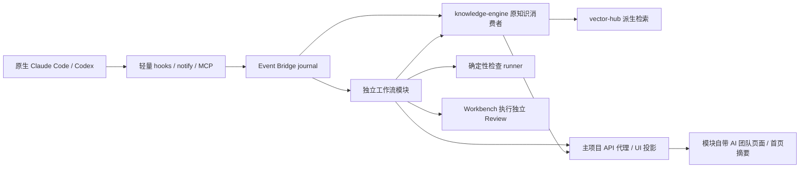

# 独立工作流模块与 AI 团队开发测试计划

状态：供 Zcode／GLM 连续执行的实施规范。用户报告已推进 W0–W2 后停止，实际通过范围须核对代码和测试收据，不在本文代标 PASS。初始审查始于 2026-11-14，后续修改遵循用户最新续跑要求。

实施必须同时阅读本文和[Zcode 执行与回归验收手册](ai-workflow-zcode-execution-runbook.md)。本文确定架构、领域、接口和技术失效合同；执行手册确定用户操作、工作包、回归命令、E2E、证据和发布次序。两份文档不要求读者掌握原聊天记录。用户之后的明确指令优先；出现冲突应报告具体条目，不自行重选架构或降低验收标准。

已确认：工作流模块独立私有源码仓库、独立 npm 包及服务；AI 团队是该模块的业务和页面；Workbench 提供执行能力。一个默认团队跨项目复用，新增“AI 团队”主导航，继续原生 Claude Code／Codex 开发，默认自动记录和审查，全部当前有效证据满足后自动交付。最终产物包括 npm 核心包、插件能力和 Windows 安装包。本文的新文件/API 为实施目标，不能当作现有功能。

本次仅落盘文档，不创建远端仓库、不写业务代码、不安装工具、不运行产品回归、不发布或切换日常安装。后续让 Zcode 开发时使用执行手册中的启动指令；正式发布仍遵守既有真实人工验收及发布工作流要求。

**连续执行要求：W0–W8 是同一交付任务的内部阶段。阶段通过后自动进入下一阶段，中间报告不结束执行，不等待用户逐项说“继续”。恢复时先核对已有 W0–W2 的源码和收据，从实际未完成处接续，不重做已验证工作。测试失败先修复重跑；外部受阻时继续所有不依赖该条件的工作。只有全部已授权开发、回归、官方产物验收和发布完成，或确实没有任何可推进工作且需要用户/外部条件，才结束当前执行并准确报告状态。**

## 1. 建议与投入边界

值得先做的是跨项目任务记录、可复现的质量门禁、按需独立 Review，以及把现有记忆组合绑定到稳定的 Agent 成员。这些直接对应“并行项目不知道进度”“核实交付费力”“AI 不断堆代码”三个问题。是否增加更多 Agent，要由新增有效发现、人工节省和交付耗时决定。

已确定新增独立工作流模块，保留现有四个模块，形成五个固定 npm 运行模块；主导航由五页增加为六页。“AI 团队”页面和业务随工作流包交付，主项目提供入口、反向代理、项目注册和模块守护。不得把成员、任务、审查状态机迁入 Workbench 或 shell。长期记忆继续只由 knowledge-engine 管理，不新建第二套记忆存储或公司组织管理平台。

先用两小时整理真实工作基线，单项探索性技术验证的一个开发日预算用于限制试验扩张，不是整个交付任务的停止条件。用户已要求完整实施 W0–W8，无需逐阶段重新确认；难点、成本或收益风险及时报告，并继续可执行工作，不自行取消已确定需求。生产实施按第 12 节分批估算。

暂缓组织树、多层 PM、Agent 市场、跨机器 federation、自动删代码和无人审核的生产发布。允许独立先验证质量 CLI，不能因为任务看板尚未交付而阻碍已有检查工具产生价值。

此前的[价值验证计划](ai-workflow-value-validation-plan.md)保留详细对照方法；后续开发的模块分工、接口、迁移和验收以本文为准。

## 2. 用户需求与最终验收

| ID | 需求 | 最终可验收行为 |
| --- | --- | --- |
| R1 | 继续使用 Claude Code / Codex | 完成一次接入和客户端要求的信任后，在支持的事件处自动采集、更新；无需改用网页开发 |
| R2 | 多项目、多任务总览 | 每个任务展示项目、阶段、业务状态、运行情况、最近活动、阻塞、下一步和来源；同任务多会话不重复统计 |
| R3 | 知道每天做了什么 | 按本地工作日生成有证据的活动及交付摘要；“有活动”“提交了代码”“已验证交付”分开 |
| R4 | 固定工作流与下一步 | 目标/验收→实现→程序检查→适用的 Review→整改复查→交付；小改动可以按规则跳过不适用步骤并说明原因 |
| R5 | 提醒与规划 | 展示依赖、明确期限、待决定事项和可执行下一步；只对有意义变化和已配置提醒通知 |
| R6 | 诊断 Agent 慢 | 展示有真实计时的阶段及未知部分；可区分等待、工具、验证和返工，不把多 Agent 当作默认加速方案 |
| R7 | Review Agent | 稳定成员身份，按用户规则审查正确性、复杂度、重复、未使用项和过时代码；给出具体证据及整改方案 |
| R8 | 外接质量工具 | CLI 为第一接入方式，MCP 可选；支持 clang-tidy、JS/TS 和 Go 工具，保留工具、规则、配置、环境及退出状态 |
| R9 | 控制代码膨胀 | 每次实质代码交付检查复用、替换旧路径和安全删除机会；不按净删行数考核，不为指标制造新抽象 |
| R10 | 给 Agent 成员绑定记忆组合 | 创建成员后绑定多个已有组合；项目绑定继续有效；同一记忆复用 ID，不复制正文 |
| R11 | 成员记忆长期管理 | 管理器展示组合被哪些项目、成员使用；解绑不删记忆；共享编辑展示影响；成员在不同会话中保持身份 |
| R12 | 输出可靠且运行安全 | 程序门禁不能被模型改口覆盖；过期/缺失结果不算通过；测试和开发不打断日常实例 |
| R13 | 独立工作流模块 | 私有源码仓库、固定 npm 运行包、独立服务和数据；Workbench 只承担模型/会话执行 |
| R14 | 面向用户的独立入口 | 六页主导航，AI 团队四页签、三步建队、项目启用及可接续任务详情 |
| R15 | 回归验证开发是否通过 | T01–T32、U01–U33、I01–I08 和 RG01–RG17 形成源版本及产物一致的证据矩阵；缺失不算通过 |
| R16 | npm 与 Windows 正式交付 | 精确模块包→核心 next→官方安装→草稿安装包验收→核心 latest→公开同一份安装包 |
| R17 | Zcode 不自行改变方向 | 按 W0–W8 顺序实施，阶段报告及验收闸门必需；不替换架构、伪造人工声明或通过删除测试放行 |

需求不包含让系统任意操纵用户正在运行的原生客户端。采集会话、后台发起独立 Review、把结果在下个受支持入口交还客户端，是三种不同能力，分别验收。

## 3. 实际代码审查结果

### 3.1 审查基线

下表为最初审查时的历史基线，不是后续执行时机器仍停在该版本的断言。Zcode 已进行开发或来源对齐后，恢复时核对当前源码、提交和收据，保留有效进度；不得因表中旧版本把新源码退回或重新实施已经通过的阶段。

| 对象 | 实际基线 | 本轮确认的事实 |
| --- | --- | --- |
| 主项目 | `main`，`4a60238`，5.0.35 | 四模块固定 npm 依赖，主界面五页；存在用户未提交文件，本轮不整理或覆盖 |
| Workbench | 安装包 0.13.13；源码 `4291887`，声明 0.13.13 | 有会话、driver、原生后台任务历史、委派预留及派发事实 |
| Event Bridge | 安装包 0.7.4；源码 `c2e311a` | 持久化 journal、项目身份、独立 consumer、每 journal ACK 游标 |
| knowledge-engine | 安装包 0.2.9；本地源码 `e9d316c` 声明 0.2.8 | 安装包已有 schema v4 和记忆组合；本地源码没有 `src/memory-groups.js`，关键文件哈希也不同 |
| vector-hub | 安装包/源码声明 1.0.8-rc.8；源码 `7ec3667` | 通用检索与索引；当前 HTTP 检索有项目、文档类型过滤，没有成员身份授权合同 |

版本相同也不能单独证明源码与交付物相同。开工前必须对照 runtime manifest 和相关文件哈希确认实际来源。尤其不能从本地 engine 0.2.8 直接开发后覆盖已安装的 0.2.9：必须先找回 0.2.9 对应源码及测试，保留已交付的记忆组合和上下文增量能力。本轮未同步仓库、修改依赖或覆盖安装包。

### 3.2 能复用什么，缺什么

| 证据位置 | 已有能力 | 缺口及设计影响 |
| --- | --- | --- |
| [module-bridge.js](../../_site/lib/module-bridge.js) | 明确 shell 只连接、代理、投影；四模块动态端口、运行身份、注册接线 | 工作流状态机不放进 shell，不写回知识生成队列 |
| [Workbench HTTP](../../../claude-ai-workbench/packages/server/lib/http-handler.js)、[服务](../../../claude-ai-workbench/packages/server/lib/workbench-service.js) | 会话摘要、`/sessions/changes`、事件游标、原生任务只读历史 | 业务任务跨会话/项目的定义、验收与成员模型仍需新增；原生 taskRef 不能替代业务 taskId |
| [委派账本](../../../claude-ai-workbench/packages/server/lib/delegation-store.js)、[派发事实](../../../claude-ai-workbench/packages/server/lib/delegation-phase-store.js) | 稳定预留、幂等、派发不明不盲目重投 | 复用其可证明结果语义；不能把 reservation 当作已执行，也不能伪装后台 Review 来自不存在的父会话 |
| [Bridge consumer](../../../ai-coding-event-bridge/packages/console/src/bridge/core/consumer-registry.js)、[HTTP](../../../ai-coding-event-bridge/packages/console/src/server.js) | 独立消费者、分 journal 游标、ACK 后裁剪 | 新消费者必须先持久化再 ACK；停用时不能遗留消费者长期阻塞裁剪，也不能跳过未保存事件 |
| [采集事件](../../../ai-coding-event-bridge/packages/console/src/bridge/core/event-schema.js)、[conversation-store](../../_site/lib/conversation-store.js) | 项目/会话/轮次身份、采集完整性、来源字段 | 事件必须经过版本化适配；客户端事件集合不同，不能承诺所有请求和工具耗时都有数据 |
| [context-hook](../../plugins/project-knowledge/scripts/context-hook.cjs)、[Codex 状态](../../_site/lib/codex-context-status.js) | 原生输入前读取 engine 上下文、端点核验、超时降级；Codex 信任状态诊断 | 当前请求没有可信成员绑定；Hook 输出日志也不能证明模型实际收到或采用上下文 |
| [已安装 memory-groups](../../node_modules/@sanqianx/ai-coding-knowledge-engine/src/memory-groups.js) | 组合↔记忆、项目↔组合，修订冲突及按 memoryId 去重 | `memberMemoryIds` 是组合内的记忆 ID；当前无 Agent 成员绑定。应新增成员关系，保留现有字段含义 |
| [已安装 context](../../node_modules/@sanqianx/ai-coding-knowledge-engine/src/context.js)、[memories](../../node_modules/@sanqianx/ai-coding-knowledge-engine/src/memories.js) | 项目适用性、会话首次索引、增量记忆；缓存键含 project/client/session | 统一 resolver 要增加可信 member 上下文及授权/绑定修订，覆盖所有读取路径 |
| [记忆准入](../../node_modules/@sanqianx/ai-coding-knowledge-engine/src/memory-eligibility.js) | 长期用户偏好必须有真实 human 原文与证据 | Review 自述不能进入该通道；工程经验需要单独类型/候选审核合同 |
| [当前 UI](../../ui/product.js) | 首页、记忆、项目、搜索、活动；活动中的 run 是知识维护任务 | 开发工作与知识维护需要可辨类别；不能把维护完成误画成用户功能完成 |
| [当前测试入口](../../_site/_test/run-all-tests.js)、[QA 基座](../../qa-autopilot/README.md) | 子测试隔离 data/knowledge/Bridge，已有安装、模块、UI 和生命周期工具 | 需补齐客户端 home/config、成员隔离、代码快照及保护实例实际身份的验收；全套测试不能绕过隔离预检 |

`background-task-registry-test.js` 检查的是 shell 后台操作 Promise 的维护，并不是持久业务任务管理。现有测试名、原生 Agent task、维护 run、产品业务任务必须分别解释。

本轮是有范围的源码审查，没有对所有代码完成安全/质量审计，没有运行完整回归、静态质量扫描或真实模型试验，也没有测出当前项目死代码数量。下文列出的能力缺口有代码依据；复杂度阈值、误报率和速度收益仍需试验。

## 4. 开源方案与 cvbot 的取舍

### 4.1 有可用工程积累的候选

| 候选 | 当前核对及适合借鉴的部分 | 本项目取舍 |
| --- | --- | --- |
| [Paperclip](https://github.com/paperclipai/paperclip) | MIT，审查时仓库未归档且近期有提交；稳定成员、任务线程、适配器、预算、依赖唤醒、审查权限 | 借鉴机制；首版不安装、嵌入或 fork 为第二套任务平台 |
| [Superpowers](https://github.com/obra/superpowers) | MIT，未归档；规格、计划、适当测试、验证后交付和独立审查的技能流程 | 借鉴流程模板；本仓 main 开发及适量测试优先，不照搬 worktree 分支或每步都启动模型 |
| [mattpocock/skills](https://github.com/mattpocock/skills) | MIT，未归档；需求澄清、规格、纵向任务切片、依赖图和代码审查 | 借鉴短任务合同、上下文引用和分离规格/质量审查；其 implement-spec 明确使用集成分支及每票分支，与本仓规则冲突，不能原样安装执行 |
| LLVM / ESLint / Knip / golangci-lint 等 | 具体质量规则由可重复的程序实现 | 直接采用工具，通过小适配器统一执行结果；不自行实现复杂度分析器 |

Paperclip 官方说明支持 Claude/Codex 等运行适配器；这证明可以由它启动 Agent，不等于可以无缝接管任意已在运行的原生会话。[概念与适配器说明](https://docs.paperclip.ing/guides/welcome/key-concepts/)

Paperclip 当前本地部署还带有自己的 UI/API 和嵌入式 PostgreSQL；源码开发列有较新的 Node、pnpm 与可选 runner 构建要求。直接接入会增加另一套任务/执行身份、数据迁移及运维成本。[部署说明](https://github.com/paperclipai/paperclip#quickstart)

本轮还读取了 Paperclip 的[依赖唤醒实现](https://github.com/paperclipai/paperclip/blob/master/server/src/services/issue-dependency-wakeups.ts)和[审查权限实现](https://github.com/paperclipai/paperclip/blob/master/server/src/services/issue-review-policy.ts)：值得借鉴的是同一依赖就绪状态去重、避免自己阻塞自己后反复唤醒、以及服务端区分可作出裁决的主体。借鉴机制不意味着复制整套代码，也不把其权限默认值用于本项目。

采用决策已锁定：独立工作流模块作为唯一团队和任务主库，复用现有四模块，开源方案只用于学习具体机制。Zcode 不安排另一个平台选型阶段，不自行切换 Paperclip、LangGraph 或其他运行时，也不双写两套任务主库。重新选型属于产品范围变化，须明确列出理由后交回用户决定。

本轮未安装或实际运行这些候选；“成熟”指可查阅的功能、代码和工程机制，不是对本机兼容性或用户收益的实测结论。实施时锁定依赖版本，不能让主分支最新内容自动改变工作流。复制获许可的代码时保留相应版权和许可证声明。

### 4.2 公司 cvbot 可以学什么

提供的[公司手册](../cvbot%20AI%20团队工作流%20与%20人类工程师手册（详细版）.md)描述的是特定公司环境，本文没有访问其私有实现仓验证全部运行细节。

- 保留明确责任人、结构化委派、证据报告、单独的运行与知识状态、故障升级，以及“原缺陷跑红、修复后跑绿”的有效回归思想。
- 先把 PM 的大部分工作做成确定性聚合：列任务、标依赖、找缺失证据、生成待办。需要比较方案或理解业务争议时再调用模型。
- 测试关注风险与行为，简单文案或可逆低影响改动无需制造测试；不追求测试数量增长。
- 公司的独立测试仓、飞书/Gitea、联邦发现、资源管理员、知识分支制度和 cron 不作为本项目默认基础设施。沿用本项目既定知识引擎和主分支治理。

## 5. 总体架构与数据归属



| 领域 | 唯一主数据归属 | 不承担的职责 |
| --- | --- | --- |
| 项目注册、模块映射、端点与凭据下发 | 现有 shell 接线 | 不保存另一份任务状态机或成员记忆正文 |
| 默认团队、稳定成员、业务任务、工作流、检查点、审查、日报、提醒和 AI 团队页面 | 独立工作流模块 | 不保存供应商凭据，不复制 Workbench 驱动，不直接写知识树 |
| Profile、凭据、Agent 驱动、受信执行和会话历史 | Workbench，继续复用现有接口 | 不管理团队/任务主数据，不作业务交付裁决 |
| 采集事件与 commit boundary | Event Bridge | 不推断业务完成，不生成工程结论 |
| 记忆、组合、项目/成员绑定、生效 resolver、工程经验候选 | knowledge-engine | 不接管用户开发任务调度，不放宽原用户偏好准入 |
| 索引与相似度检索 | vector-hub，纯派生 | 不作为任务主库或成员权限裁决者 |
| 规则配置 | 各项目 Git 中的工具配置及质量策略 | 记忆不维护另一套可冲突的执行阈值 |

工作流源码仓库定为 `ai-coding-workflow`，本地路径 `D:\SanQian.Xu\ai-coding-workflow`，公开 npm 运行包定为 `@sanqianx/ai-coding-workflow`，首版 `0.1.0`，服务标识 `workflow`。源码仓库保持私有，运行包只包含必要运行代码、页面、CLI 和文档，不含用户数据、凭据或测试输出。公开 npm 包中的运行代码可被下载，私有源码仓库不等于运行代码保密。

采用 Node.js ≥22、CommonJS，服务端首版使用 Node 标准库，UI 使用现有产品的原生 HTML/CSS/JS 方式，不新增前端构建框架。目录按 `src/`、`ui/`、`test/`、`docs/` 分开。CLI `ai-coding-workflow serve --data <目录> --host 127.0.0.1 --port <端口>`；独立/嵌入共用领域服务，所有测试生命周期命令必须显式选测试数据目录。首选端口 5810，使用现有动态端口身份核验机制，冲突更换空闲端口，不终止既有监听者。

UI 通过模块自己的 `/` 页面交付；主项目在“AI 团队”中以同源嵌入模式代理页面及静态资源，支持 `embed=1`、可配置 `apiBase` 和项目/主题/可见性消息，精确校验 origin/source。不重写消息流，也不把整页团队实现复制进 `ui/product.js`。首页和项目内只投影短摘要。独立模块保持可单独启动和查看任务的能力，相关实现必须先通过工作包 W1 的包边界验收。

数据使用工作流自己的 dataDir，每个聚合一份原子 JSON，写入由单写者锁管理，revision/CAS 防并发覆盖；事务内保存业务事实、事件 inbox、待发送 outbox 和待 ACK 游标，之后再发出副作用。任务列表索引可从记录重建，不作为第二个事实源。历史输出用独立只追加文件，按保留期压缩归档。不得把所有完整对话复制进去，也不得写入 Workbench 的数据目录。

文件存储须通过崩溃恢复、并发和规模目标后才可生产启用；不通过时记录失败并修正当前实现，不能静默丢事件或自行引入数据库。确需变更存储方案时报告证据和成本，等待明确范围决定。knowledge-engine 继续遵守其零依赖与单写者约定。

原子保证以单个聚合记录为边界，不假定多个 JSON 文件能一起提交。跨任务依赖通过可重放 outbox 传播，接收者核对当前 revision 并幂等处理；一个 journal 事件涉及多个目标时，只有全部派生写入已持久化，或原事件已完整进入可恢复 inbox，才允许推进对应消费水位。恢复时从该 inbox 补齐未完成投影，不能依赖已经 ACK 并可能被裁剪的 journal 再取一次。

所有路径由模块 dataDir 派生：工作流在各自安装的 `<dataDir>/workflow/`，engine 绑定在 engine 状态，Workbench 仅保存自身执行/会话状态；审查快照和报告在工作流运行产物目录。任务日志按配置保留，长期确认记忆独立保存。成员是产品身份，模型会话只在有任务时启动，创建成员不等于常驻一个模型进程。

## 6. 身份、实体及可信状态

### 6.1 最小实体

| 实体 | 必备字段及约束 |
| --- | --- |
| `Team / ProjectWorkflowSettings` | 每 brain 一个默认 teamId、名称、成员引用和固定工作流；项目启用、自动审查及检查配置单独保存；首版无多团队选择 |
| `AgentMember` | `memberId, brainId, name, role, instructionsRef, driverId, profileId, model, toolsetId, allowedProjectIds, revision, enabled`；独立于模型/会话。凭据只引用现有 profile |
| `Task` | `taskId, projectId, title, goal, sourceRefs, acceptance[], scope, priority, dueAt, dependencies[], ownerMemberId?, phase, status, nextAction, blockers[], revision`；优先级/期限保留设定来源 |
| `SessionBinding` | `bindingId, taskId, memberId?, client, nativeSessionId, workbenchSessionId?, workspaceIdentity, validFrom/To, revision, verificationBasis`；使用命名空间，禁止同名跨客户端碰撞 |
| `Checkpoint` | 任务及验收 revision、当前快照、已确认决策、已验证结果、剩余项、下一步、事件引用、更新时间；推断标为候选 |
| `WorkflowDefinition` | `workflowId, version, steps, applicability, requiredChecks, transitions, retryPolicy`；运行固定版本，不因模板后来修改追溯改写历史 |
| `WorkflowRun / StepRun` | 稳定 runId、attempt、输入版本、状态、排队/执行时间、执行身份、子会话和运行结果引用；业务 taskId 不复用原生 taskRef |
| `ReviewRun` | `taskId, acceptanceRevision, baselineSnapshotId, candidateSnapshotId, policyHash, toolchainHash, memberRevision, memorySetHash, checks[], findings[], verdict` |
| `Finding / Receipt` | 规则和工具原始 ID、文件/符号/位置、证据、基线对照、执行命令参数、退出状态、环境及完整性；AI 建议和程序发现分开 |
| `Reminder / DailyDigest` | 任务引用、触发规则/本地时区/到期时间、去重键、投递状态；摘要每条结论引用事实，允许“未观测” |

核心项目 ID、Workbench `contextId`、Bridge `journalId`、engine 项目 ID 经现有接线映射关联，不能互相代用。Workbench 现有 `agentId=claude/codex/...` 是 driver 选择，新成员字段统一称 `memberId`。

任务可以有多个会话和运行；同一原生会话切换任务必须以带生效时间/轮次的明确绑定切段，不能把整个会话后续事件永久算给第一项任务。无法确定所属的事件进入“待关联”，不靠标题相似自动合并。关闭任务保留审计；有新范围时新建任务或显式变更验收 revision。

### 6.2 三种状态必须分开

- 业务任务：`draft → ready → in_progress → verifying → in_review → done`，允许 `blocked / cancelled`。有效证据失败后回到相应整改阶段；关闭后的新代码变化提示交付状态待复核。
- 执行尝试：`queued / starting / running / waiting_user / succeeded / failed / cancelled / dispatch_unknown`。成功运行一次不等于任务完成。
- 观测健康：`connected / stale / disconnected / partial / unknown`。长期无事件不是代码失败，模型仍在运行也不是进度百分比。

任务 `done` 由服务端依据当前验收 revision、候选快照、所有必需检查和有效裁决计算，不接受模型直接写 `done=true`。没有可程序验证的文档/设计任务允许明确的人工验收收据；显示其验收类型，不能伪装成测试通过。人工对确需豁免的规则留下有范围、理由和有效期的 waiver，原始失败记录仍保留。

界面用“已验收 2/4 项”表达检查结果，并展示项目阶段；不从 token、行数或时间编造 80% 的进度。后端完成态、前端状态筛选和日报必须使用同一判定。

## 7. 原生客户端自动接入与事件恢复

### 7.1 接入后的日常体验

首次设置项目接入与工作流选择；原生会话中通过一个短命令/技能建立或选择当前任务，后续有意义的检查点自动更新。客户端或仓库不支持的事件明确显示覆盖缺口。没有 task/member 绑定时保留原项目知识上下文，不自动给普通聊天套用某位 Review 成员的记忆。

轻量采集事件优先复用现有 Bridge hooks/notify，避免在插件和 Bridge 各写一套重复会话采集。需要新增生命周期事实时，先扩展 Bridge 版本化采集契约；不要把任意工具输出塞进现有 user/assistant 事件再声称已完整支持。Workbench 管理会话的摘要/changes 用于其执行层投影，外部原生会话仍以采集证据为准。

Hook 主路径仅进行有界请求或原子入队，服务不可用时在隔离的本地 spool 保留事件/显式标记失败，原生开发可继续。服务返回接收成功必须说明持久化程度；重试保留原事件幂等 ID。采集失败和质量验收未完成分别展示，不能把 fail-open 的可用性降级变成质量通过。

当前 Claude 与 Codex 官方文档均描述异步 command hooks，但事件、输出交付时机和超时语义不同：Claude 异步输出在后续轮次交付，非交互退出可能取消未完成 Hook；Codex 在安全点交付信息，空闲时不会因 Hook 完成自动开启新轮次。[Claude hooks](https://code.claude.com/docs/en/hooks#run-hooks-in-the-background)、[Codex hooks](https://learn.chatgpt.com/docs/hooks)

因此长任务交给服务队列，Hook 只投递，不依赖 Hook 自己活到 Review 结束。结果先保存在任务卡；可在下次受支持的上下文入口/MCP 查询取回。是否支持中途直接唤醒某客户端，必须按实际客户端版本单独证明。保留 Codex 的用户审查/信任流程，更新 Hook 后重新信任的状态可见，不调用绕过信任参数。

### 7.2 事件与故障合同

1. 为工作流注册独立 consumer，例如 `workflow:<storeId>`，显式订阅项目 journal；不复用 engine 的 ACK。
2. 逐 journal 读取 `(journalId, sequence)`，同时保留原 eventId、workspace/session/turn 和捕获完整性；不同 journal 的 sequence 不比较大小。
3. 验证 schema 与身份，将事件 inbox、派生状态及待 ACK 水位原子持久化；提交之后才 ACK。崩溃后重放不能重复建任务、派发或发送通知。
4. 遇缺口记录 `gap`，通过仍存在的 journal/封存会话记录修复；无法补回就标未知。已经裁剪或从未捕获的数据不宣称全部恢复。
5. 对副作用使用稳定 `requestId + payloadHash`；同 ID 不同 payload 返回冲突。派发超时/崩溃后的 `dispatch_unknown` 先对账，不能自动重复提交。
6. 同项目同工作目录默认一个写入者；读取 Review 固定快照。不同项目可按资源预算并行，初始全局模型 Review 并发 1、程序检查按成本限流；不停止用户健康的长任务。
7. 已持久化消费积压、断线时长、队列深度和失败原因可见。消费者停用必须显式完成积压交接或保留恢复点后解除订阅，防止无限占住 Bridge 裁剪水位。

新增自动化默认只观测。项目启用自动审查后，以下触发进入合并队列：显式提交审查、工作流进入验证、或已配置的 commit 检查。连续输入/保存/同快照事件合并；Review 输出引发的新对话不能再次无限触发 Review。更改代码后生成新快照，旧成功只作历史证据。

## 8. Agent 成员记忆：沿用长期记忆管理

### 8.1 存储及生效规则

成员的长期记忆继续放在 knowledge-engine 管理的现有长期记忆系统；成员身份、指令、工具配置和短期运行记录归独立工作流模块。凭据只引用 Workbench profile。两者通过稳定 ID 关联。禁止每个成员新建一个相互复制正文的“独立脑数据库”。

在 engine 新增 `agentMemberSubjects` 最小身份投影与 `memberGroupBindings` 关系。前者只保存工作流模块注册的 `memberId, brainId, memberRevision, enabled` 等核验元数据，成员主数据仍只在工作流模块；后者保存 `bindingId, memberId, groupId, brainId, project/language applicability, revision`。保留既有 `memberMemoryIds`、`boundProjectIds` 和项目组合 API。

有效记忆 = 现有适用的已确认记忆 ∪ 项目绑定的已确认组合记忆 ∪ 当前可信成员绑定且满足适用条件的已确认组合记忆，然后按 `memoryId` 去重，保留全部 `sources`。同一 brain、有效成员、授权项目范围与语言条件取交集。成员绑定不会把其他项目专属事实提升成全局信息，也不授予源代码写入、外发或发布权限。

管理器中可以创建 Review 成员、开发成员等，再从已有组合中多选绑定；同角色两位成员允许使用不同组合。成员详情显示职责、执行配置、工具、绑定组合和某项目下的最终生效预览。组合详情增加“使用此组合的项目/成员”及影响范围；共享正文修改沿用同一条记忆，解绑仅删除关系。禁用成员立即阻止新运行和新上下文解析，历史审查仍可追溯。

### 8.2 身份核验、读取隔离及缓存

由工作流模块在创建任务运行或明确关联原生会话时，通过受信本机模块通道向 engine 注册有期限的 context binding，绑定 `brain/project/client/session/task/member` 及修订。注册 API 不向普通浏览器或任意 MCP caller 暴露服务凭据；前端传一个 `memberId` 不能获得成员记忆。Workbench 仅为实际由它执行的会话提供执行身份证明，不拥有成员授权表。

原生会话使用任务接入生成的短期关联凭据，在可校验客户端会话 ID 后消费并绑定；没有足够会话证据时只能使用项目记忆，不降级为相信模型自报姓名。会话切换任务/成员、移出项目授权、组合解绑、成员禁用都撤销旧 binding。服务间更新通过 outbox 幂等重放；身份投影未就绪显示 pending，不能扩大读取范围。

统一 resolver 接收经核验的上下文，用于注入、搜索、ask/get/history 的记忆读取、UI 生效列表、文件 fallback、向量返回和缓存。没有成员上下文的旧接口保持项目行为。管理器管理权限和执行会话读取权限区分，不用前端隐藏代替服务端过滤。

缓存键加入绑定/授权 epoch 与生效集合 revision/hash。解除关系后在下一次请求重新解析，给现有会话返回移除标记；已被模型读过的内容无法从其历史上下文抹除，严格切换需要新会话。不能宣称清缓存能让模型“忘记”。

初版不缓存跨请求的成员授权成功结果：engine 每次读取成员记忆时，通过受信只读校验向工作流模块核对 binding 与当前成员/项目授权 revision；该校验只读身份记录，不再次请求上下文，避免调用环。工作流不可达或身份投影不同步时不返回成员专属内容，项目记忆按原规则处理。Workbench 不可达只影响新后台执行，不让工作流已有任务和成员记录无法查询。engine 内的组合撤销在本地立即参与解析，不能等待向量更新或 outbox 到达。以后若增加授权缓存，须明确可接受的撤销延迟并另行验收，不能仍宣称下一次请求立即生效。

初版成员记忆从授权 resolver 直接读取，不依赖新建向量权限系统。通用向量检索不能绕过 resolver 返回未授权的记忆文本/片段/数量；必要时对执行入口禁用通用 memories 召回，由 engine 取回已授权项。索引只是候选来源，返回正文前再次按当前授权核验，索引未更新也不能泄露。vector-hub 的原始管理接口不暴露为成员执行工具。

### 8.3 应保存什么

| 信息 | 落点和准入 |
| --- | --- |
| 用户明确指定的长期编码偏好 | 现有长期记忆候选/人工确认及原始 human 证明；项目与成员可共享引用 |
| Review 检查顺序、可复用审查注意事项 | 成员指令/确认后的成员组合；一般开发也必须遵守的规范同步绑定给开发者 |
| clang-tidy 等启用规则、阈值、ignore | Git 里的真实配置；记忆保存理由、适用范围及配置引用，不能偷偷覆盖执行值 |
| 已核实的误报、动态入口和工程经验 | 新的 `engineering-lesson` 候选类型：带项目、工具/规则版本、复现证据、适用范围和复查条件，经确认后生效 |
| 某次告警、完整工具输出、进度与聊天 | task/run/evidence 及必要的原会话记录，按保留策略管理 |

`engineering-lesson` 与用户偏好区分来源和 UI 标识，不能伪造 `inputOrigin=human`。若试点尚未实现其审核合同，只保留审查记录，允许用户按现有手工确认流程提炼；不自动灌入长期记忆。冲突规则显式提示：执行门禁按当前 Git 策略，记忆解释不能放宽门禁。

## 9. Review Agent 与确定性工具门禁

### 9.1 审查执行顺序

1. 冻结任务验收、规则、基线与候选代码。候选包含追踪文件及本次明确纳入的未跟踪源文件，记录路径、模式/链接与内容哈希；不能只记 HEAD 漏掉工作树改动。
2. 在隔离目录物化只读源快照。构建输出/缓存写独立目录，保留相同锁文件与必要生成步骤；缺依赖/生成内容明确失败。C++ 编译数据库须在隔离构建中生成或按验证规则重定位，不能继续引用正在变化的原工作目录。
3. 服务拥有的检查 runner 按固定工具版本和配置执行，在基线和候选之间对比。必需工具缺失、解析异常、构建不完整、超时或结果截断都不算通过。
4. 程序门禁产生标准报告；Review 模型读取短任务合同、差异、受影响上下文和报告，按需展开代码。默认没有修改原仓库、策略、ignore 或运行服务的能力。
5. 输出行为缺陷、规则失败、重复/旧路径、删除或简化候选、验证充分性和未知项。每项保留文件/符号、触发条件、证据和建议；不能只报一个主观健康分。
6. 当前开发 Agent 在既有任务授权范围内整改，执行有价值的回归；每次生成新候选快照。复查只针对变化和关联影响；循环默认最多两次自动尝试，仍失败保留阻塞和下一步，不无限调用模型。
7. 所有必需检查对当前快照有效、验收满足且无未处置阻断项才可交付。Review 模型失败不会删除已完成程序收据；要求独立 Review 的任务保持待审。

程序检查的稳定性来自固定输入、版本、环境、规则和明确解析；测试与构建仍可能不稳定，重复执行不能挑一次成功覆盖失败。对 flaky 结果保留尝试和解释，不能承诺所有工具输出逐字一致。

只读权限通过执行工具和路径边界实现：Review 只获得固定快照内读取、搜索及报告查询工具，初版不提供通用 shell 或任意文件写入工具；调用质量 CLI 的权限归受控 runner。提示词里的“不要修改”不能代替权限限制。构建和测试可能执行项目配置/脚本，必须在独立运行环境中执行并限制其目录、凭据和服务连接，运行后重新核对快照完整性。

这里的“阻断”首先约束本系统的验收和交付状态。异步 Hook 不能阻止用户在原生客户端继续改代码，也不能保证禁止所有本地 commit；如项目需要合并级强制门禁，应复用同一规则及收据在其现有 CI/合并检查执行。客户端前置 Hook 可作快速反馈，但不能单独当作不可绕过的质量保障。本次不创建或变更远程仓库规则。

同一代码内容下更改验收、规则、编译选项、锁文件或必需测试集合，也会使对应证据失效。缓存键使用 `candidate + baseline + policy + toolchain + environment + acceptanceRevision`，Review 还包含成员指令/记忆集合版本。原始输出按摘要哈希关联，收据来自 runner 的实际子进程，模型复制一段终端文本不能伪装 runner 收据。

### 9.2 工具组合及职责

| 项目 | 第一选择 | 检查范围及边界 |
| --- | --- | --- |
| 本仓 JS/CommonJS，其他 JS/TS | ESLint + Knip；按样本增加 jscpd / dependency-cruiser | ESLint 负责复杂度、函数长度、嵌套等规则；Knip 检查未使用文件/导出/依赖；重复和边界按需启用，不同时堆满所有工具 |
| C/C++ | clang-tidy；格式另用 clang-format | 明确选择 google-* 与 readability-function-size 等适用规则；固定编译器、宏、包含路径和 compile_commands；不能宣称覆盖所有 Google 标准或证明全部死代码 |
| Go | golangci-lint | 按固定版本选择 funlen/gocyclo/gocognit/dupl/unused 等，固定 Go 版本、平台和 build tags |
| 多语言补充 | Lizard 或 jscpd 的适用能力 | 作为选配，先校准解析能力、指标定义和误报；不把不同语言/工具的“复杂度”混成同一数值 |

依据：[ESLint complexity](https://eslint.org/docs/latest/rules/complexity)、[Knip 入口说明](https://knip.dev/explanations/entry-files)、[Knip 告警处理](https://knip.dev/guides/handling-issues)、[jscpd](https://github.com/kucherenko/jscpd)、[dependency-cruiser](https://github.com/sverweij/dependency-cruiser)、[clang-tidy](https://clang.llvm.org/extra/clang-tidy/)、[函数尺寸规则](https://clang.llvm.org/extra/clang-tidy/checks/readability/function-size.html)、[Go linter 配置](https://golangci-lint.run/docs/linters/configuration/)、[Lizard](https://github.com/terryyin/lizard)。版本选型和许可证复核在正式引入时记录，不在本轮安装。

本仓先建立入口清单：`package.json` 的 bin/main/exports/scripts、`_site/server.js`、动态模块入口、插件 hooks、浏览器 HTML/script 引用、MCP 启动器、测试工具和 runtime manifest。四个固定 npm 模块属于受保护运行依赖，不能因动态引用未识别被自动判为可删除。第三方、生成和本地运行产物不进入手写业务代码指标，排除理由须有边界依据。

Google 风格规则与函数大小只是质量的一部分。clang-format 解决格式，clang-tidy 提供具体静态检查；不可据此自动证明某个 C++ 逻辑无调用或删除安全。C++ 首个真实接入要选择用户实际构建项目；本仓为 JS，不能只扫描本仓就宣布 C++ 已完成验收。

### 9.3 CLI/MCP 适配器合同

不自行开发复杂度解析算法；每个工具只写执行/结果适配。CLI 使用 `spawn(executable, args, {shell:false})`，路径和参数分离，中文、空格路径必须测试；默认禁止 auto-fix。MCP 适配器也必须提供同等工具身份、输入版本和真实执行证据，不能因“来自 MCP”就当作可信通过。

```text
ToolAdapter
  id / adapterVersion / supportedLanguages / capabilities
  executableRef / versionProbe / requiredConfig / environmentProfile
  buildArgs(snapshot, policy) -> argv[]
  parse(stdout, stderr, exitCode) -> findings + completeness + executionStatus
  reportFormat / exitCodeMeaning / timeout / outputLimit / resourceClass
  writePolicy=read-only-source / permittedOutputDirs / networkPolicy

NormalizedFinding
  toolId + toolVersion + sourceRuleId + metricDefinition + unit
  file + symbol + range + measuredValue? + threshold? + severity
  baselineMatch + fingerprint + evidenceRef + confidence + applicability
```

优先 JSON/SARIF，clang-tidy 等使用其可验证的结构化导出/诊断解析方案；文本需独立解析器及固定样本。未知版本/格式拒绝“零告警”。退出非零可能是发现违规，也可能是执行失败，各工具分别解释。完整性、执行状态和规则 verdict 独立。

### 9.4 反膨胀策略

- 建立历史基线，优先阻断新增/恶化问题。基线失败也要展示，不能伪造基线为零；移动/重命名按稳定指纹对照，无法匹配保留待核实。
- 修改函数检查完整函数；修改依赖检查受影响图。诊断落在未修改的函数声明行也不能因“只看 diff 行”被漏掉。死代码/依赖扫描必要时分析整个入口图，再区分本次新增和历史债。
- 阈值先告警校准，再对明确规则阻断。可以用函数逻辑长度、分支/嵌套、复杂度、重复 token、新增依赖和测试验证价值分别判断；不设置全语言一个阈值，不用强拆函数规避真实复杂度。
- 删除候选必须给出调用/入口检索、运行时使用说明、替代路径、兼容性与回归证据。公共 API、动态插件、配置开关、兼容逻辑和外部消费者无法证明无用时保留待核实。
- 测试审查关注真实断言、缺陷触发和独立价值；重复测试可以合并，必要回归必须保留。bug 修复优先证明修复前失败/后成功；对非行为变更无需机械写新测试。
- Review 不能更改规则/ignore/阈值以放行自己的任务。规则调整作为独立、有依据的策略变更，失效缓存并重新验证；不自动全仓清理历史债。

首版质量策略文件建议 `.ai-quality/policy.json`，只引用真实工具配置和门禁等级，不复制工具规则的执行值。配置/基线/适配器版本进入 Git，生成的报告与临时快照进入忽略目录。

## 10. 固定工作流、日报及速度诊断

默认团队最少包含开发成员和 Review 成员。程序验证 runner 是服务能力，无需为了执行 CLI 再养一个模型 Agent。任务规划先用模板和依赖规则；只有需要业务判断时才调用规划模型。

| 步骤 | 输入 | 完成条件/输出 |
| --- | --- | --- |
| 明确任务 | 原始需求、当前项目与已知约束 | 短任务合同、验收项、范围、下一步；不重新询问已有答案 |
| 规划切片 | 合同、依赖、当前授权 | 可独立验收的小切片，已有代码引用；低风险小改动直接实现 |
| 实现 | 当前切片、适用项目/成员记忆、工具规则 | 修改及必要删除，更新快照/检查点；同工作目录写入串行 |
| 程序验证 | 固定候选、适用检查集合 | 真实工具/测试收据及规则判定 |
| Review | 合同、差异、受影响代码、收据 | 具体问题、简化/删除建议、未知项；适用的小改动可按策略免模型 Review |
| 整改复查 | 已核实问题及对应版本 | 新快照、新证据，失败不自动当完成 |
| 交付/接续 | 当前有效验收与审查 | 当前成果、未完成项和下个动作；正式知识仍走现有引擎晋升 |

日报默认基于任务和事件规则生成，不为写一段总结强制开模型。按 Asia/Shanghai 工作日切分，保存实际时区与起止 UTC；显示当日活动、已验收交付、进行中/阻塞及明日候选。跨午夜、重复事件、同任务多会话必须去重。模型润色可选，不能添加未发生的工作或把 idle 写成完成。

提醒优先站内：明确等待用户、实际检查失败、计划到期、依赖变为可执行、观测断线。合并重复通知，支持已读/延后/静默和单条任务关闭；未知截止时间不虚构告急。自动建议下一步按用户优先级、到期时间、依赖和 WIP 上限排序，展示理由；不擅自给自由时间排满日程。外部飞书/邮件/GitHub 写入不在默认实施范围。

速度采样使用单调计时记录队列、运行、工具/验证、等待、返工和协调开销；可取得时附模型请求/额度信息。并行步骤不重复累加为总用时，核心比较采用从任务接受到验收的实际经过时间。对原生客户端缺少的网络/模型内部阶段标未知，不从安静时长猜测。依据最大瓶颈优先减少重复检索/全量上下文、合并验证、缓存同版本结果和减少无用交接；每项优化独立对照，不默认增加并发。

## 11. 接口、修改位置与兼容合同

以下均为待新增接口。工作流模块独立 API 基址为 `/api/workflow/v1`，shell `/api/workflow/*` 反代到该基址；UI 与静态资源由独立的页面代理路径 `/workflow-ui/` 提供。原有 `/api/terminal/*` 继续只代理 Workbench 执行接口，不改作团队业务入口。管理面写入要求同源校验和显式管理权限，服务间调用使用受信本机身份，浏览器与模型均拿不到服务令牌。

| 接口族 | 建议接口 | 关键合同 |
| --- | --- | --- |
| 默认团队/项目启用 | `GET/POST /team`；`PATCH /team`；`GET/PUT /projects/:id/settings` | 每 brain 一个默认团队；requestId 幂等、revision 冲突；创建/启用不启动模型 |
| 成员 | `GET/POST /members`；`GET/PATCH /members/:id` | 稳定 ID、revision、禁用及工具引用；组绑定由 engine 管理 |
| 业务任务 | `GET/POST /workflow-tasks`；`GET/PATCH /workflow-tasks/:id` | cursor 分页、按项目/状态筛选、CAS；done 只能通过验收裁决动作 |
| 绑定/接续 | `POST /workflow-tasks/:id/session-bindings`；`POST /workflow-tasks/:id/checkpoints` | 明确 task/member/client/session 与时间段；幂等 requestId；候选与事实区分 |
| 审查/执行 | `POST /workflow-tasks/:id/reviews`；`GET /review-runs/:id`；`POST /workflow-tasks/:id/acceptance-decisions` | 快照及策略固定；重复请求重用原收据，不跨版本复用通过 |
| 投影/时间线 | `GET /workflow-overview`；`GET /workflow-changes?after=...`；`GET /daily-digests` | 首屏有界、revision/重连快照、类别区分、数据缺失可见 |
| 提醒 | `GET/POST /reminders`；`PATCH /reminders/:id` | 本地时区、去重、确认/延后和持久恢复；不自动开启外发 |
| engine 成员组合 | `GET /api/agent-members/:id/memory-groups`；`POST .../bind`；`GET .../effective-memories?projectId=...` | 管理 API 核验成员身份投影、brain 与授权；组关系有独立 revision |
| engine 内部关联 | `POST /api/internal/agent-member-subjects`；`POST /api/internal/context-bindings`；撤销动作 | 仅受信服务可写，幂等、过期、撤销；context/search 不能接受未经核验的身份声明 |
| 工作流内部核验 | `POST /internal/context-bindings/validate` | 只读当前身份/授权 revision；仅受信 engine 调用，不执行模型或回调上下文 |
| Workbench 执行适配 | 优先复用 sessions/input/changes；缺少受信幂等后台执行能力时新增仅服务间执行入口 | 只管理 executionId、sessionId、profileRef、运行收据；禁止存入成员/业务任务主数据，禁止伪造父会话 |

新增 MCP 工具固定为 `project_workflow_start/resume/status/checkpoint/request_review/review_result`，经现有插件与 MCP 入口调用独立工作流主库，不额外存一套状态。新增技能 `pk-team`，首版显式 start/resume/status/review 可靠，隐式自然语言触发只作便利能力。成员配置、规则变更和运行工具能力与只读查询分开授权。所有执行工具使用服务核验的项目与快照，拒绝调用方随意传绝对目录越过范围。JSON 写入正文带 requestId 和 expectedRevision，成功返回实际记录及 revision；同请求不同载荷/CAS 冲突为 409，不静默覆盖；done 不接受普通 PATCH。

| 仓库 | 修改位置和拆分目标 | 相关既有回归 |
| --- | --- | --- |
| 新工作流仓库 | `src/` 团队/任务/存储/消费/检查/审查/提醒，`ui/` AI 团队，`test/` 合同及回归 | 新模块 unit/contract/integration/UI/故障与包验证，须纳入 CI |
| Workbench | 保留既有 Profile/driver/session；只补足工作流所需的执行适配及可验证收据 | unit、integration、contract；委派幂等、native-task、history、权限和 SDK 检查 |
| Event Bridge | consumer 合同按需补齐；增量生命周期采集及版本化 connector 测试 | journal/compaction/consumer/commit boundary、各原生 connector 回归 |
| knowledge-engine | 从正确 0.2.9 源码出发改 store/groups/resolver/context/读取及候选准入 | 项目组合、legacy scope、准入、注入增量、文件 fallback、删除/解绑与持久化 |
| vector-hub | 默认不新增团队功能；如证明确需索引元数据能力再小幅扩展 | 当前跨项目过滤、document 获取、重建/降级不退化 |
| 主项目 | 新模块 wiring/能力探测/守护，导航/同源页面代理/首页摘要，原生接入/MCP 代理及五模块清单 | 记忆、原生上下文/采集、模块生命周期/安装、六页导航与嵌入回归 |

新增“AI 团队”主导航，六页顺序为首页、AI 团队、长期记忆、项目、知识检索、活动记录。团队页四页签为任务、成员、工作流、工具与接入；全部项目为默认筛选。三步建队、任务详情和原生操作见执行手册第 3–4 节。首页只增加跨项目摘要，项目详情增加启用状态和任务摘要；活动页区分开发任务、质量审查和知识维护。组合详情增加“使用此组合的成员”。

空态要区分“没有任务”“尚未接入”“数据未同步”“服务不可达”。同一页面更新、异步搜索与项目切换采用 revision/epoch 防旧响应覆盖新项目。每个证据入口直达具体 run/finding/snapshot，不能只跳回泛化活动首页。

## 12. 开发顺序、预算与价值闸门

估算按一位熟悉代码的工程师、正常评审和调试计；是人日范围，模型执行不能把它直接换算成承诺日期。首次遇到来源、Windows 工具链或客户端能力缺口时重新估算。

| 阶段 | 工作包 | 预计投入 | 通过条件，通过后自动继续 |
| --- | --- | --- | --- |
| W0 | 版本来源、现有失败基线、隔离保护、任务收益基线 | 2–4 人日；基线整理≤2h、单项 spike≤1d | 正确 engine 源码、可执行隔离预检和基线报告 |
| W1 | 独立工作流包、服务、数据、页面代理、五模块安装和能力接线 | 3–5 人日 | 可独立及嵌入启动；故障不拖停其他模块；I01–I08 初验 |
| W2 | 默认团队、成员、项目启用、创建向导及四页签 | 3–5 人日 | U01–U06；刷新/重试后无重复和伪就绪 |
| W3 | 任务、原生 MCP/技能、绑定、检查点、全局总览与接续 | 4–7 人日 | Claude/Codex 各完成真实开始/接续，无猜测归属 |
| W4 | engine 成员组合、可信读取、缓存撤销、迁移和管理 UI | 4–6 人日 | 旧项目记忆不退化；全读取路径隔离与撤销生效 |
| W5 | 快照/收据、JS 程序检查、后台 Review、整改复查和自动交付 | 5–8 人日 | 已知违规失败→整改通过；假通过/旧证据无法完成任务 |
| W6 | 真实 C++ clang-tidy、Go 工具链及适用性 UI | 3–5 人日 | 各语言真实失败/整改/合法反例、环境缺失测试 |
| W7 | 日报提醒、耗时诊断、全量用户 E2E/回归/规模及收益观察 | 3–5 人日 | G0–G5 闸门、需求证据矩阵和资源/价值报告 |
| W8 | 模块发布、核心 next、Windows 草稿包、官方安装和正式发布 | 3–5 人日 | 官方产物一致，真实人工验收；G6–G7 及发布收据 |

包括独立模块、用户流程、真实客户端回归和双产物发布的总投入初估 30–50 人日，观察周期另计。预算用于范围控制，不是执行承诺。每项工作包的细分步骤、前置条件、必须测试和退出证据见执行手册第 5 节；没有退出证据不得标为完成。最小 CLI 校准可在 W3 前独立开展，不因此改变模块归属。未知源码来源、认证、真实 C++ 构建或 VM 缺口需立即报告并保留未完成状态。

每个阶段按一个纵向切片交付 API、UI、必要测试及可复核证据，通过后自动推进下一工作包。表中的通过/退出条件指结束当前阶段并进入下一阶段，不代表整个任务结束。不同仓只在 `main` 开发，保留用户未提交工作。同项目代码写入串行，跨项目并行受资源预算约束；未经用户要求不创建常驻功能/QA/备份分支。

价值验收建议在开始观察前固定：

- 样本为至少 2 个真实项目、5 项任务、8 次切换，观察至少 5 个工作日；用当前正常工具方式作基线，接入修复的收益单独统计。
- 在 1 分钟内找齐样本活跃任务、正确阶段/阻塞/下一步；查询/接续人工时间中位数较基线减少至少 30%。
- 质量试点至少 5 次差异：检查出可独立复核的新问题或把核实时间减少至少 20%；重复告警不算新增收益。记录误报处理、配置维护和所有模型开销。
- 时间型功能的预期周净节省至少 1 小时，开发投入预计 8 周内回收；未达到时报告缩减未来扩展的建议，不自行终止已经授权的 W0–W8。防缺陷收益单列，有真实案例再计，不虚构货币收益。
- 慢速优化针对观测出的主要阶段，目标减少其耗时至少 20%，并检查端到端没有被协调/排队抵消。小样本不足时写“证据不足”，不包装成统计证明。

上述数字用于实际价值评估，不是已测效果，也不是程序正确性测试的替代品。五工作日观察与开发并行，样本不足保留为交付后 PENDING 观察项，不阻止可完成的技术验收和已授权发布；不得编造收益。是否缩减既定产品范围由用户决定，执行 Agent 不以“模板可能足够”自行结束当前交付。

## 13. 开发测试方案

### 13.1 测试环境与日常实例保护

先改进/复用现有 QA 隔离基座，再运行任何新增生命周期验收。测试安装使用独立 prefix 和合成仓库；data、knowledge、workflow/Workbench/Bridge/vector/engine 状态、客户端 HOME/config/cache、浏览器 profile、工具构建和报告目录全部独立。测试进程不继承日常模块 URL、服务令牌或真实模型凭据；真实模型验收只显式提供测试需要的 profile。

生命周期测试前只读发现受保护实例实际 runtime identity、主进程和全部已安装模块 PID/创建时间/父子关系/命令路径、最终监听端口及健康。当前为四模块，未来包括工作流模块，不能把测试保护固定写死为四个。不得只保护默认的 5757/5760 等端口。测试申请空闲端口，冲突换端口或失败，绝不停止原监听者。

测试 start/status/stop 都必须显式选择测试 dataDir；清理依据启动收据中的 PID、创建时间和路径再次核验，只处理本轮创建进程。禁止不带 dataDir 的 stop、按 `node.exe` 名杀进程、覆盖全局安装、将测试模块连接真实服务或把测试知识写入真实目录。若现有脚本不满足条件，先修 harness，相关测试记 blocked。

测试前后比较受保护进程身份与健康；真实 data/knowledge 可能因用户正常工作变化，不能要求其内容哈希完全不变，也不能据此宣称“没有任何写入”。以连接/写入边界的可执行保护和独立收据说明归因。只有用户以后明确要求切换日常安装时，才执行正式升级；开发测试授权不包含该操作。

可复用测试和小型合成 fixture 生成器进 Git；报告、截图、日志、安装包、快照和临时 clone 进入现有忽略目录。特别注意 `_site/_test/fixtures/*` 当前默认忽略，新增固定 fixture 要么有明确例外，要么用已跟踪生成器产生，不能验证通过却漏进交付包。

### 13.2 必须覆盖的故障与反例

| ID | 层次/场景 | 必须观察到的结果 |
| --- | --- | --- |
| T01 | 存储：相同 requestId 重试、不同 payload 重试、并发 CAS | 原 ID/收据复用；冲突明确；无重复任务或静默覆盖 |
| T02 | 存储：临时写入、原子提交、outbox 发送前后分别崩溃 | 要么保留原状态要么重放一致；不重复副作用；损坏数据保留并报错 |
| T03 | 事件：两个 journal 都有 sequence=10、乱序、重复、空页 | 不串项目/游标；按各自水位重建；不回退或漏 ACK |
| T04 | 事件：持久化前/后、ACK 前/后崩溃，journal 被裁剪 | 持久化前不 ACK；重放无重复；缺失显式 gap，不伪造恢复 |
| T05 | 事件：新 consumer 离线、停用、恢复 | 积压可见；无擅自跳水位；退出订阅有交接记录，无永久无声阻塞裁剪 |
| T06 | 任务：回复结束/idle/commit/后台任务完成 | 只更新相应运行事实，缺少验收不能变 done |
| T07 | 任务：一任务多会话、会话切任务、同名路径/嵌套仓库 | 同任务不重计；按绑定区间归属；歧义进待关联 |
| T08 | 接入：Claude/Codex 正常、未信任、旧版本、缺失事件 | 能力矩阵真实；无需重复安装采集；缺覆盖可见，不干扰正常开发 |
| T09 | 接入：服务断线、重放、响应丢失、重复插件/Bridge 事件 | spool/重试幂等；无事件丢失假象或重复派发；Hook 有界 |
| T10 | 派发：输入已送达但收据丢失、服务崩溃 | dispatch_unknown 阻止自动重复输入；恢复先对账 |
| T11 | 快照：HEAD 不变但工作树/未跟踪源文件/规则/验收变动 | 原检查过期；所审代码包含明确纳入内容；无跨版本通过 |
| T12 | 工具：真实违规、工具缺失、异常非零、超时、解析失败/截断 | 区分 fail/error/incomplete；任何必需检查缺证不能 pass |
| T13 | 工具：未知版本、中文/空格路径、参数含 shell 元字符 | 不执行参数拼接；未知格式明确拒绝；路径身份正确 |
| T14 | 增量：历史问题、移动函数、告警位于未改声明行 | 不漏掉新恶化，也不要求本次清掉所有旧债；不靠 diff 行过滤漏报 |
| T15 | 入口：动态 require、bin/exports、HTML script、hooks、固定模块 | 工具入口建模正确；不自动建议删除受保护运行依赖 |
| T16 | 删除：静态不可达但有动态/公共使用，纯冗余旧路径 | 前者保留待核实；后者给调用/入口及回归证据；不以净减行数打分 |
| T17 | 测试：恒真断言、无效重复、缺陷回归 | 能指出证据不足；必要回归保留；真实 bug 用例前红后绿 |
| T18 | Review：模型说通过但程序失败、模型改 ignore/阈值 | 服务端门禁不放行；策略改动不偷偷接受，原失败保留 |
| T19 | Review：模型超时/不符合输出合同/调用失败/反复整改 | 程序收据保留；适用任务待审/受阻；不无限循环或编造发现 |
| T20 | 只读边界：模型或工具尝试改源代码/配置/访问其他项目 | 原目录无修改；越界执行拒绝；快照被工具修改则结果无效 |
| T21 | 组合：创建两个同角色成员，各绑不同组合，项目也绑同组 | 精确生效；同 memoryId 一份正文，多来源可追溯 |
| T22 | 成员身份：伪造 memberId/binding、过期关联、跨 brain/project | 执行入口拒绝/保持项目记忆；无成员内容泄露；不借用默认 reviewer |
| T23 | 读取：context/search/ask/get/history/vector/file fallback/cache | 相同已授权集合；直接路径及检索片段不能绕过；旧接口项目语义不扩大 |
| T24 | 撤销：解绑/删除组/禁用成员/会话切换/共享记忆编辑 | 下一次请求重新解析并更新缓存；其他关系不受误删；共享影响可见 |
| T25 | 准入：delegation/unknown 原文、模型“经验”、人工偏好 | 原 human 准入不放宽；工程候选单列；无来源不晋升 |
| T26 | 迁移：旧 v3/v4 合成状态、重复启动、写盘失败、旧包打开新版 | 迁移前备份与校验；不改旧正文/关系；失败可重试；旧包拒绝新版而非重置 |
| T27 | UI：切项目、分页、旧异步响应、无任务/未接入/断线 | 当前身份及筛选准确；旧数据不覆盖；证据链接到对应 run |
| T28 | 日报/提醒：跨午夜、重放、重启、已读/延后、权限等待 | 工作日正确、无重复工作/通知；不编造完成；不向外部服务发送 |
| T29 | 速度/并发：长模型任务、多个项目、验证资源拥堵 | 限流可解释；不自动杀健康长任务；并行区间不重复累计 |
| T30 | 生命周期：端口占用、失败启动、清理、supervisor 恢复 | 只管理本轮进程；保护实例 PID/健康一致；不覆盖全局安装 |
| T31 | 模块兼容：旧新能力组合、安装包与源匹配、清单遗漏 | 能力不足显示不支持；不无声丢字段；五个固定模块及运行清单完整，旧四依赖保留 |
| T32 | 端到端：原生开发→任务→审查失败→整改→复查→接续 | 每步有同 task/版本证据；新会话只取适用记忆；最终交付可独立复核 |

测试只为关键行为和失效风险而写，不为每个字段 getter、文案或内部函数机械增加一套镜像用例。固定工具样本用于验证适配器，真实工具反例用于验证其确实发现问题，两者不得相互冒充。

### 13.3 真实工具、客户端和模型的分层验证

1. 合成数据的单元/合同测试：存储、状态机、解析器、幂等、resolver、权限和失效，不调用付费模型。
2. 真实 CLI 集成：JS 有复杂度/重复/unused/动态入口样本；C++ 有 compile database、宏/include、头文件影响、尺寸违规与合法反例；Go 有 build tags、平台差异、unused 与合法反例。每工具包含“已知应该失败”与“整改后应该通过”。
3. 五模块隔离集成及浏览器：固定依赖打包安装、真实 API、空态和失败态、六页回归、记忆管理、证据直达与重连。以 API/进程收据验证状态，以浏览器验证用户确实能操作。
4. 原生客户端：使用独立测试 HOME/config/trust/profile，在 Claude 与 Codex 各跑真实小任务及断线场景；检验实际采集和上下文送达。仅有 Hook 自己输出文件不能作为模型送达证据。
5. 有界真实模型 Review：同一固定样本多次运行观察有效发现、遗漏、误报与用量；硬门禁结果保持由程序决定。对代表性案例独立核对，模型一致措辞不是成功指标。
6. 真实工作收益观察：只在测试验收后按用户选定项目接入观测，不改其业务数据作夹具；记录基线/新增维护成本和净收益。

初始性能验收目标：合成 20 项目/1,000 活跃或近期任务/100,000 历史事件时，首屏有界列表 p95≤1s；采集后本机正常队列投影 p95≤5s；新增 Hook 投递开销 p95≤200ms、硬等待预算≤1s（不含既有上下文读取耗时）。在固定硬件、工具链和基线负载下测量并保存分布；不达标先定位再调目标或设计，不能把计划数字写成实测结果。

首阶段同时记录后台 CPU、内存、磁盘和原生开发体感/耗时，防止总览/扫描本身拖慢开发。重检查按快照去重、资源限流，不每个保存都全仓扫描；队列暂停和退订要有可恢复语义。

### 13.4 回归入口与证据交付

沿用各仓 canonical 测试入口：主仓 `npm test`、Workbench `npm run verify`、Bridge `npm test`、engine `npm test` 及适用 web/fault suites；新工作流模块固定提供 `test/test:contract/test:integration/test:tools/test:web/test:real/test:package`。vector 有修改才跑相关 `npm test/build`，最终五模块集成安装仍必需。精确测试矩阵、当前六个 CI job 和新增工作流/UI 必需 job 见执行手册第 6 节。命令必须由通过隔离预检的 harness 包裹，不可直接继承真实路径/模块 URL。

新增功能先跑受影响的有意义测试；正式候选再跑所需跨模块与安装/运行清单验证，包含主仓 `runtime:verify`、`release:verify` 及现有产品/集成门禁。先阅读这些命令的副作用，区分只读检查与 sync/自动修改。通过后仅在新改动或发现风险时扩大重跑，不靠增加重复测试轮数制造信心。

每个里程碑交付：被验收源 SHA/快照、依赖版本和包哈希、规则/环境哈希、测试命令及退出码、失败及重试记录、原始报告摘要引用、受保护实例前后身份、未覆盖限制与价值结果。只有真实执行才能标 PASS，未执行、环境阻塞和部分覆盖分别列出。

## 14. 迁移、能力发布与回退

### 14.1 数据迁移

新工作流模块状态独立版本化，不改现有 Workbench 会话历史/native task/delegation 文件含义；原生会话默认未绑定，不能升级时批量猜测用户所有任务。不得从 Workbench 导入不存在的旧团队数据；当前尚无该模块，不编造迁移历史。

engine 从安装包现有 schema v4 增加新 schema 版本，新增成员身份投影/关系/context binding 存储，保留 legacy scope、组合/项目关系、正文、指纹和 tombstone。v3 兼容链先按既有迁移到 v4，再到新版本；在隔离合成状态和用户显式指定的离线副本上演练，不能拿真实正在写入的状态作试验。

迁移先做一致性备份与清单，检查 brain/项目/记忆/group 引用、revision 和重复关系；临时写入验证后原子替换，磁盘错误或崩溃保留原状态可重试。迁移不需要实际更改记忆内容/知识树文件，所有派生索引可重建。大状态迁移持有单写者锁，不能与正在运行的旧进程同时写。

### 14.2 兼容与启用顺序

服务暴露版本化 capabilities：工作流查询、审查、成员绑定/读取隔离分别声明。新 shell 遇旧模块显示未支持；成员隔离未具备时不能仅启用成员绑定 UI。旧客户端没有 member 上下文时保持项目记忆，新增字段不改变旧 taskRef/agentId 含义。

先在独立安装验证匹配的模块组合，再生成包及清单候选、保留原四依赖并新增第五个精确依赖、更新完整 runtime manifest。更新所有“恰好四模块”的逻辑和测试，不能删除原边界检查。跨仓变更在各自源码仓完成，通过正常 npm 模块交付链更新主项目，禁止编辑 `node_modules` 当作源变更或将 engine vendoring 回主仓。工作流停用只停新派发/消费，保留任务；卸载默认保留数据和恢复点，原四模块正常运行。

生产开关按能力逐项启用：任务观测 → 程序检查告警 → 规则阻断 → 按需模型 Review → 成员组合 → 原生自动触发 → 日报提醒。前一项可关闭而不删除任务/记忆，新增功能故障不阻断原生编码和已有知识服务。关闭阻断门禁不能伪造任务验收通过，应显示未执行/未验收。

### 14.3 回退

故障先关闭新增触发/通知/模型执行，保留历史证据和恢复水位；避免无限重试，并确保消费者停用有明确策略。独立模块恢复已验证的旧包不能直接读取不支持的新 schema；二进制回退与数据回退必须配对。

如新版本运行后已有新记忆/绑定写入，直接还原迁移前备份会丢新数据。此时优先前向修复或离线导出差量后再回退；无损降级需要独立迁移实现及测试，不能口头保证。正式回退/升级涉及日常实例停止或替换，仍需用户明确要求该操作。

产品实施以执行手册 W0–W8 和 G0–G7 为准。W8 明确列出 npm next、真实安装验收、Windows 草稿包及正式发布，不代表本次文档落盘已执行这些操作。日常实例升级仍是独立授权事项。任何模块故障、迁移或环境缺口只能留下真实的未完成记录，不能用模型自述代替回归或产物验收。

## 15. 后续成员 版本与文档维护 Agent

### 15.1 增量范围和职责

用户提出后续增加“版本与文档维护 Agent”。它是同一工作流团队的可添加成员，role 为 `release-docs`，不是第六个运行模块，不新建服务或另一套记忆系统。默认团队仍按当前 W0–W8 的两个成员交付；本节作为之后 D0–D3 增量，不让正在执行的开发重新从 W0 开始或停下等新范围。当前 W8 已要求的版本同步、用户说明、Release Notes 和接口使用文档仍要完成，不能以“文档 Agent 尚未实现”为由省略。

角色目标：公开接口变化时，API 契约、调用说明、可运行示例、版本、变更日志和兼容性说明一起更新；文档整理改善可发现性和一致性，不增加无依据的文档数量。普通功能改动不强制新建一篇说明，优先更新对应的已有规范入口。

| ID | 后续能力验收 |
| --- | --- |
| DR01 | 在现有成员页添加该成员，选择现有模型/工具/记忆并按项目启用；没有任务时不常驻运行 |
| DR02 | 区分各模块包版本、HTTP API 兼容版本、OpenAPI 格式版本、数据 schema 和文档适用版本；不强制全仓统一版本 |
| DR03 | 维护模块接口清单、鉴权/调用边界、参数/响应/错误、分页/事件及兼容性，能识别缺文档和过期示例 |
| DR04 | 关键公共调用有真实可运行示例，至少覆盖 HTTP/curl.exe 或 PowerShell 及 JS fetch/已有 SDK；环境和预期结果明确 |
| DR05 | 程序检查接口/文档/示例/版本的一致性，模型不能覆盖失败或用样例 JSON 冒充实际执行 |
| DR06 | 写入仅在项目已启用的文档/示例及明确发布计划范围；不改业务逻辑、测试、编码规则、凭据或知识引擎产物 |
| DR07 | 整理保留有效内容、稳定链接和历史版本依据，合并/移动有引用清单及验证，不按删除文档数考核 |
| DR08 | 产生有证据的版本建议、CHANGELOG/迁移说明及已审发布材料；正式版本、tag、发布和日常升级仍走已有流程 |

### 15.2 规范项目的最低文档合同

| 文档 | 必须回答什么 | 维护规则 |
| --- | --- | --- |
| README/快速开始 | 模块用途、适用版本、安装/启动、必要环境、最短可用流程 | 指向规范 API 与示例入口，不复制整份规范；区分独立与 shell 代理地址 |
| API 契约和说明 | HTTP method/path、公开/内部权限、参数/schema、响应/错误、分页/SSE、幂等、超时/取消语义 | 按实际支持的公开接口维护；内部管理能力有边界说明，不把服务令牌发给普通客户端 |
| 调用示例 | 导入/安装何种包、配置 base URL、请求、读取结果、失败处理、清理示例产生的测试资源 | 关联实际模块/API 版本，参数化端口/ID/测试凭据；真实执行验证 |
| 模块集成说明 | 谁调用谁、项目/会话身份映射、注册、事件和断线恢复、版本兼容 | 引用各模块的规范合同，不重新发明另一套接口 |
| CHANGELOG/迁移/发布说明 | 增加/修复/弃用/不兼容、影响范围、升级与回退限制 | 开发中写 Unreleased；固定发布版本后再归档，不伪造发布日期或已发布状态 |
| 文档索引 | 当前规范入口、历史资料、旧版本和迁移路径 | 复用现有目录索引；没有索引时建立一个，不为每个目录生成重复概述 |

文档优先是项目源码仓库中的可审查文件。knowledge-engine 生成的知识树有单写者约束，维护 Agent 不直接写其 README/modules/changes 或长期记忆正文；需要沉淀的发现走现有知识/候选通道。

Workbench 已有 OpenAPI 3.1.0、SDK README/INTEGRATION 和 sdk 校验，应先复用并扩充。其他 HTTP 模块逐步建立对应可验证契约，新工作流模块使用 `docs/api/openapi.json`（JSON 便于标准库读取），保留既有模块格式，不为统一样式升级或转换整套工具。OpenAPI 是描述 HTTP API 的标准，并不自动证明实现和文档一致；必须有实际合同测试。[OpenAPI 3.1.0 规范](https://spec.openapis.org/oas/v3.1.0)

本轮只读发现 Workbench 的部分 SDK README 安装示例仍固定 `0.2.0`，engine README 包含旧安装版本和历史 vendoring 语句。它们是待核对候选，不直接认定接口失效或全局替换：结合文档的适用版本、当前代码、包来源和示例运行结果判断应更新还是标历史。

### 15.3 每个接口和示例的必要内容

每个公开操作记录 operationId/工具名、用途、所属模块、适用包/API 版本、method/path 或 SDK 方法、权限/前置、请求字段（类型/必填/默认/约束）、成功/错误响应、分页/事件/幂等适用语义、至少一个成功示例及典型失败处理。未实现功能明确标 planned，不混入当前可调用接口。

示例优先复用 `examples/` 中可运行源文件，文档引用或在检查时比对这些文件；不要手写两份互相漂移的正文和可执行代码。每个示例声明入口、支持语言、适用操作、环境变量、期望断言和清理方式。先覆盖实际消费者使用的 HTTP、JS/SDK、Windows PowerShell，不为排面另建 C++/Go 客户端 SDK。

示例的 base URL 由测试安装的实际身份/端口提供，不能默认连用户日常 5757/5760/5790 等端口。示例中的 sessionId/projectId 来自同次示例流程，不写死别人的真实 ID。管理接口与普通接口分开，凭据使用变量或明确的无效占位值，不把真实密钥写进正文、日志或发布包。

程序应验证实际路由/schema 与契约、示例能否按公开包导入、关键请求/响应断言、典型错误、文档链接/锚点、版本/文件清单和敏感内容。路由存在、链接可打开或文档能生成都不足以代替真实调用。契约与实现冲突时报告具体差异交相应开发任务处理，不擅自把规范改成迎合实现错误。

### 15.4 版本与权限边界

公开版本采用项目已确定的语义化版本政策：稳定 API 的兼容修复/新增/不兼容分别影响 patch/minor/major；0.x 仍可能不稳定，须明确兼容策略，不能假设 0.x 次版本升级总兼容。已发布版本不可覆盖。规范来源为 [SemVer 2.0.0](https://semver.org/lang/zh-CN/)。

每个 npm 模块保留自己的版本，主产品精确锁定依赖；`/api/.../v1` 是 API 兼容版本，OpenAPI `openapi: 3.1.0` 是规范格式，`info.version` 关联接口/产品说明版本，数据 schema 独立。已有 Workbench 的 info.version 与 SDK 包版本一致是该模块合同，不能推成所有模块的同一版本号。

模型先给版本变化建议及实际差异依据；机器核对 manifest/lockfile/插件/契约/发布清单的匹配。项目已确认发布目标才使用既有同步脚本修改版本，不每次文档提交自动升版，也不自动移动 tag/latest。仅文档更改是否需新包取决于分发内容和发布政策，不能为凑号让所有未改模块一起升级。

默认可在用户对项目启用“自动文档维护”后更新已授权文档、示例和 Unreleased 记录；范围为该项目登记的规范路径，不是任意 `**/*.md`。源码写入仍服从单写者锁和输入 hash/revision，变更期间有人修改则返回冲突并重新取当前内容。版本清单只有受信发布任务带明确目标时可写；没有授权时保存补丁草案，不创建额外逐行确认流程。

不得改业务实现、AGENTS/权限配置、质量阈值、测试、凭据、真实知识/记忆数据、安装树或运行实例；不得 force-push、清理分支、覆盖发布版本或自行发布。Review Agent 审查其补丁与边界，程序检查后才允许工作流接纳。对文档移动/合并保留引用映射和必要历史入口，删除需明确替代依据，不能根据“时间旧”就删。

### 15.5 触发、记忆与可追溯结果

在开发任务的公开 API/SDK/CLI/配置/schema 变化、显式“更新文档”、发布准备等有意义检查点触发；按代码/契约/版本计划 hash 合并，不每次聊天或保存都调用。职责流程为“差异与影响清单→最小文档/示例补丁→程序检查和隔离示例→Review→同步结果”。

成员可绑定“文档风格”“版本策略”“模块接口约定”等已有确认组合，正文仍在 engine；可执行规则以 Git/脚本为准。旧版本具体接口事实来自对应代码和规范，不把模型记忆当权威，不把每个临时发布号塞入长期记忆。

每次结果保存 docsRunId、taskId/memberId、源/契约/版本计划 hash、更新文件、示例及命令收据、失败/冲突、兼容性说明和下一步。无 API 变化也要说明本次适用性；不能为了证明工作而新建一批重复文档。后续 D0–D3 和 DT01–DT12 见执行手册第 10 节；这些后续条目不替换或降低当前 W0–W8/G0–G7。
